[Home](Home) › Working on it › **AI-Assisted Development**

# AI-Assisted Development

> [!NOTE]
> **At a glance.** Much of the work on this repo since May 2026 has been done with Claude Code, an AI coding assistant, working from the instructions in `CLAUDE.md`. Small copy edits go straight to a pull request. Anything bigger follows **brainstorm, spec, plan, build**, with the spec and plan committed to `docs/superpowers/` so the reasoning stays with the code. A person always reviews the preview and decides what merges.

```mermaid
flowchart LR
    O([Owner's idea<br/>or request]):::visitor --> BR[Brainstorm<br/>options and mockups]:::ours
    BR --> SP[Spec<br/>docs/superpowers/specs]:::ours
    SP --> PL[Plan<br/>docs/superpowers/plans]:::ours
    PL --> EX[Build on a branch<br/>task by task, with review]:::ours
    EX --> PR[Pull request and<br/>Cloudflare preview]:::cloudflare
    PR --> M([Owner approves,<br/>merge and tag]):::visitor

    classDef ours fill:#FDE7DC,stroke:#E8835A,color:#1e1c18
    classDef cloudflare fill:#E3F0F6,stroke:#5B8FA8,color:#1e1c18
    classDef visitor fill:#E5F4EA,stroke:#3F8F5A,color:#1e1c18
```

## The four steps

1. **Brainstorm.** Explore options before writing code. The Soft Modern look, for example, was chosen from three visual mockups (Soft Modern, Editorial Warmth, Crafted).
2. **Spec.** Write down what is being built and why, with the decisions locked in: `docs/superpowers/specs/YYYY-MM-DD-<topic>-design.md`.
3. **Plan.** Break the spec into small tasks with exact files and checks: `docs/superpowers/plans/YYYY-MM-DD-<topic>.md`.
4. **Build.** Work through the plan on a branch, review as you go, open a pull request, check the preview, merge, tag.

Specs and plans so far: the two pillar restructure, Soft Modern, Liquid Glass (spec only), character and charisma, and the books gallery.

## What the assistant reads first

`CLAUDE.md` is the assistant's briefing. It covers the triplicate maintenance rule, French slugs, Arabic RTL, relative path depth, the stylesheet layout and the motion convention, release rules, and the note to flag changes that matter to the external technical review in the `ezzi-clarity-os` repo. Keep it current: a stale `CLAUDE.md` leads to stale work.

## Good habits on this repo

- **Check `ROADMAP.md` and `CHANGELOG.md` first.** The answer to "is this already planned or done?" is in one of them.
- **Do all three languages in one change,** and flag Arabic or French strings that need a native speaker.
- **Verify, do not assume.** Past passes used automated page sweeps (status codes, structural checks, brace balance) and focused adversarial reviews (reduced motion, no JavaScript, RTL). There is no test suite, so look at the result.
- **Never invent facts** about the practice, the founder or the books.
- **Keep docs in step.** A change that ships should update `CHANGELOG.md`, the README table, and any wiki page it makes stale.

## When to just do it yourself

A typo, one sentence, or a colour tweak is quicker by hand. The assistant earns its keep on changes that touch many files (all 20 HTML files, all three languages), on research into history and archives, and on careful verification.

## Related pages

- [Editing Workflow](Editing-Workflow)
- [Wiki Maintenance](Wiki-Maintenance)
- [`docs/superpowers/README.md`](https://github.com/vijaybpanangi/ezziclarity/blob/main/docs/superpowers/README.md)

**Last checked:** 2026-11-09, against `CLAUDE.md` and `docs/superpowers/` at `6c632f0`.

Sources

- `CLAUDE.md`
- `docs/superpowers/README.md`, `specs/` (five specs plus the Arabic checklist) and `plans/` (four plans)
- `CHANGELOG.md` v3.0.0 and v3.6.0 verification notes

