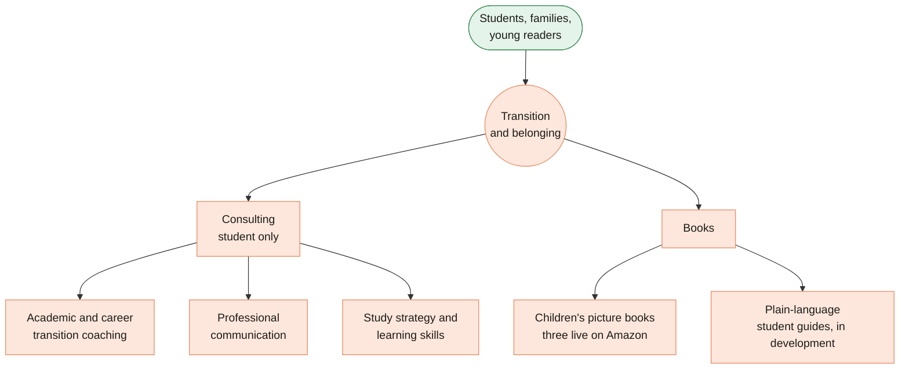

[Home](Home) › The practice › **About Ezzi Clarity**

# About Ezzi Clarity

> [!NOTE]
> **At a glance.** Ezzi Clarity Educational Consulting is a student-first practice based in Southern Ontario, founded by Arva Ezzi (MEd, OISE, University of Toronto). Since June 2026 it has two pillars under one theme of *transition and belonging*: **Consulting** for students finding their footing in Canadian academic life, and **Books** for children settling into a new country, plus plain-language student guides. The website introduces both, builds trust, and gives a clear way to book a first conversation.

## Who the site is for

- **Students**, domestic and international, who are starting or moving through Canadian post-secondary study and want practical, honest guidance. This is the only consulting audience: the institution and employer services were retired in the June 2026 restructure.
- **Families and young readers** looking for picture books about children from immigrant families learning a new language, a new school and new friends.
- **People arriving from a referral or a search** who need to tell quickly whether they are in the right place. The language gateway, the plain copy and the trust signals (credentials, languages, location) exist for them.

## What the practice offers

### Consulting

The Consulting page names three areas of support, in the practice's own words:

| Area | In short |
|---|---|
| Academic and career transition coaching | Program choices, academic expectations and early career steps |
| Professional communication | Writing, presenting and speaking in academic and workplace settings |
| Study strategy and learning skills | Managing the workload, pace and expectations of Canadian study |

Work follows a four step process shown as a timeline: listen and understand context, clarify objectives and scope, design practical steps, then support implementation and reflection. Every engagement starts with a free intro call.

### Books

Three children's picture books (ages 4 to 8) are live on Amazon.ca as of v3.8.0: *The Blanket That Remembered*, *Mei and the First Lantern* and *Nova's First Skate*. A first student guide, *Arriving and adapting: the international student's guide*, is in development. The stories draw on Arva's more than ten years of teaching children from the early years through middle school. See [Books and Buy Links](Books-and-Buy-Links).

## The founder

Arva Ezzi holds a Master of Education from OISE, University of Toronto, with a focus on student success and experiential learning, and has worked inside Canadian post-secondary institutions. The About page lists her languages as English, Hindi, Gujarati and Arabic, with working French. Visitors can reach her at `arva@ezziclarity.ca`; general questions go to `info@ezziclarity.ca`.

## The disclaimer

Every language carries the same boundary, on purpose:

> **Academic and career focused only. No immigration or visa advice provided.**

In Canada, immigration and visa advice is regulated and may only be given by licensed immigration consultants and lawyers. The line tells visitors plainly that this practice stays on the academic and career side. Keep the wording the same in all three languages whenever you edit nearby copy.

## Voice

The site speaks in a warm, plain, structured voice. The home page names its own principles: **clarity over complexity**, **grounded in real experience**, and **warm, professional, structured**. The About page adds three working principles: *we say what's true*, *we work with how things actually are*, and *we reduce complexity, not add it*. When you edit copy:

- Prefer concrete verbs and practical next steps over marketing superlatives.
- Write for a student who is a little overwhelmed: reassuring, never alarmist.
- Treat French and Arabic as first class, not as afterthoughts.

## What the site is, and is not

| The site is | The site is not |
|---|---|
| The practice's front door, in three languages | A blog or content marketing engine |
| A clear route to a first call (Titan booking link, phone, email) | A client portal or scheduling system of its own |
| A small catalogue of the books, with links to buy | A shop: purchases happen on Amazon |
| Static and easy to host | A CMS with editorial roles |

## Related pages

- [Pages and Features](Pages-and-Features): what each page shows
- [Books and Buy Links](Books-and-Buy-Links): the books pillar in detail
- [Project History](Project-History): how the positioning changed from 2025 to now
- [Decisions Log](Decisions-Log): why the practice went student only

**Last checked:** 2026-11-09, against `main` at `6c632f0` and the live site.

Sources

- `en/about/index.html`: founder background, languages, principles, contact addresses
- `en/consulting/index.html`: the three service areas and four process steps
- `en/index.html`: hero copy and "What working with us feels like" principles
- `en/books/index.html`: titles, ages, status pills
- `CHANGELOG.md` entries v2.0.0 (two-pillar restructure) and v3.8.0 (books live)
- `docs/superpowers/specs/2026-06-08-website-two-pillar-restructure-design.md`

