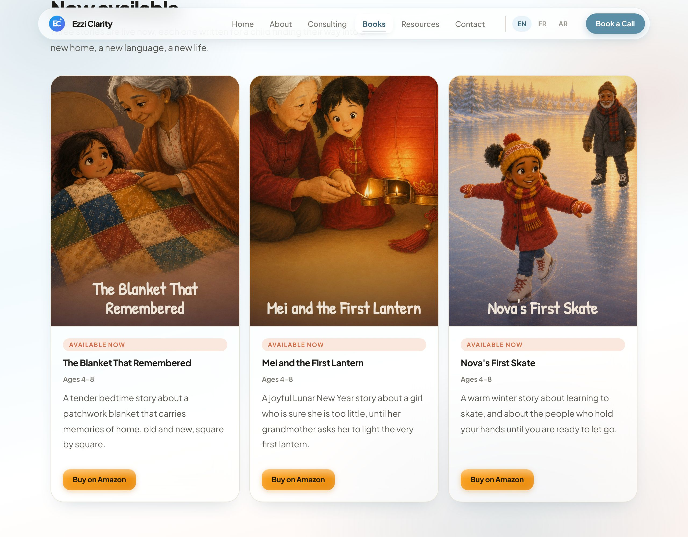
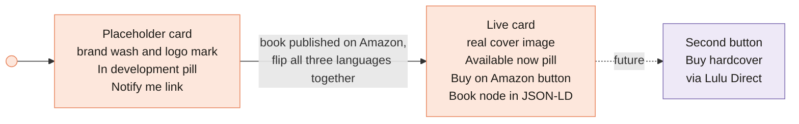
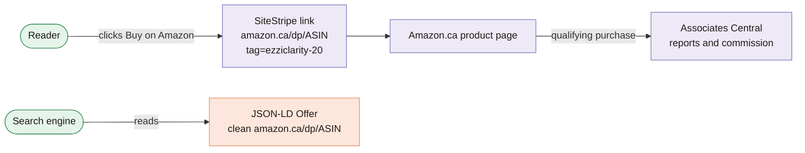

[Home](Home) › The practice › **Books and Buy Links**

# Books and Buy Links

> [!NOTE]
> **At a glance.** The Books page in each language is a small gallery of **book cards**. Three children's picture books are live with **Buy on Amazon** buttons that carry the Amazon Associates tracking ID `ezziclarity-20`; one student guide is still a placeholder with a **Notify me** link. A card moves from placeholder to live by following the `<!-- FLIP TO LIVE -->` comment in the HTML, in all three languages at once. Search engines get a clean, untagged Amazon link in the JSON-LD `Book` data.

## The catalogue today

| Title | Ages | Status | Amazon.ca ASIN | Live since |
|---|---|---|---|---|
| *The Blanket That Remembered* | 4 to 8 | Available now | `B0HG6B8LKB` | v3.8.0 |
| *Mei and the First Lantern* | 4 to 8 | Available now | `B0HG6FSXYB` | v3.8.0 |
| *Nova's First Skate* | 4 to 8 | Available now | `B0HG5Y7XWM` | v3.8.0 |
| *Arriving and adapting: the international student's guide* | Students | In development | none yet | placeholder |

All three live titles are on Kindle and in paperback. Covers live in `assets/images/books/<slug>-cover.jpg`, about 900 by 1440 pixels.

## How a card goes from placeholder to live

Every placeholder card carries the steps in an HTML comment. In short, for **each** of `en/books/`, `fr/livres/` and `ar/books/`:

1. Add the cover to `assets/images/books/<slug>-cover.jpg` (once; all three languages share it).
2. Replace the placeholder frame (`book-cover--placeholder` with the logo mark) with `-cover.jpg" alt="...">`, with the `alt` text translated.
3. Change the status pill from "In development" to "Available now" (translated).
4. Replace the **Notify me** link with the Buy on Amazon button, using the link Amazon's SiteStripe generates for that book (see below), with `target="_blank" rel="noopener sponsored"`.
5. Add a schema.org `Book` node to the page's JSON-LD `@graph`, with a clean `https://www.amazon.ca/dp/<ASIN>` offer URL (no tag) and the Amazon.ca paperback price in `CAD`.
6. Update the section heading and intro if they still talk about books "in development", and add a `CHANGELOG.md` entry and tag.

## Buy links and the Amazon Associates tag

- **Tracking ID:** `ezziclarity-20`, registered in v3.9.0. All nine buttons (three books in three languages) carry it.
- **Use SiteStripe links (v3.9.2).** The buttons use the exact link Amazon's SiteStripe toolbar generates for each book. It adds `linkCode=ll2`, a `linkId` and `ref_=as_li_ss_tl` alongside the tag, so link level reporting in Associates Central works. Do not hand build the URL.
- **`rel="noopener sponsored"`.** `sponsored` tells search engines the link is paid; keep it.
- **Structured data stays clean.** The JSON-LD `Offer.url` is the plain `/dp/<ASIN>` link, because it describes the product for search engines rather than being a click.
- **The button colour (v3.9.1).** `.book-cta .btn-primary` is a warm orange gradient with dark text, so it reads as an Amazon button without using Amazon's logo or wordmark, which their brand rules restrict. Contrast is about 8 to 1.

> [!IMPORTANT]
> **Keep the disclosure.** Amazon's Associates rules require a clear disclosure wherever tagged links appear. Since v3.9.5 each Books page shows one, centred under the book grid (`.book-disclosure`): "As an Amazon Associate, Ezzi Clarity earns from qualifying purchases." The French uses Amazon's own wording ("En tant que Partenaire Amazon, ... réalise un bénéfice sur les achats remplissant les conditions requises"), and the Arabic is a translation awaiting native review. If buy links ever appear on another page, add the disclosure there too.

## Direct hardcover sales (future)

The roadmap keeps a slot for selling signed or premium hardcovers through **Lulu Direct** (print on demand, printed in Ontario, dropshipped). The shape is undecided: a Shopify Buy Button on the site (needs a small monthly plan and a content security change) or a simple link out to the lulu.com page. The `.book-cta` row already has room for a second button. Paperbacks on Amazon and a direct hardcover can coexist.

## Styling

Book cards extend the shared `.service-card`, so they inherit the frosted glass and hover lift. The extras live in the `BOOK GALLERY (v3.7.0)` section of `style.css`: `.book-card`, `.book-cover` (a 3 by 4 portrait frame), `.book-cover--placeholder`, `.book-meta` and `.book-cta`, which pins the button row to the bottom of the card so buttons line up across a row.

## Related pages

- [Pages and Features](Pages-and-Features): the rest of the Books page
- [SEO](SEO): the `Book` nodes in context
- [Runbooks](Runbooks#publish-a-new-book): the step list as a checklist
- [Known Issues](Known-Issues): what the 2026-11-09 review found and fixed

**Last checked:** 2026-11-09, against `main` at `6c632f0` and the live Books pages.

Sources

- `en/books/index.html`, `fr/livres/index.html`, `ar/books/index.html`: cards, links, `FLIP TO LIVE` comment, JSON-LD `Book` nodes
- `style.css` lines 1164 to 1215: book gallery rules
- `CHANGELOG.md` entries v3.7.0, v3.8.0, v3.9.0, v3.9.1, v3.9.2
- `ROADMAP.md`, "Books gallery" and "Direct hardcover sales"
- `docs/superpowers/specs/2026-06-25-books-gallery-design.md`

