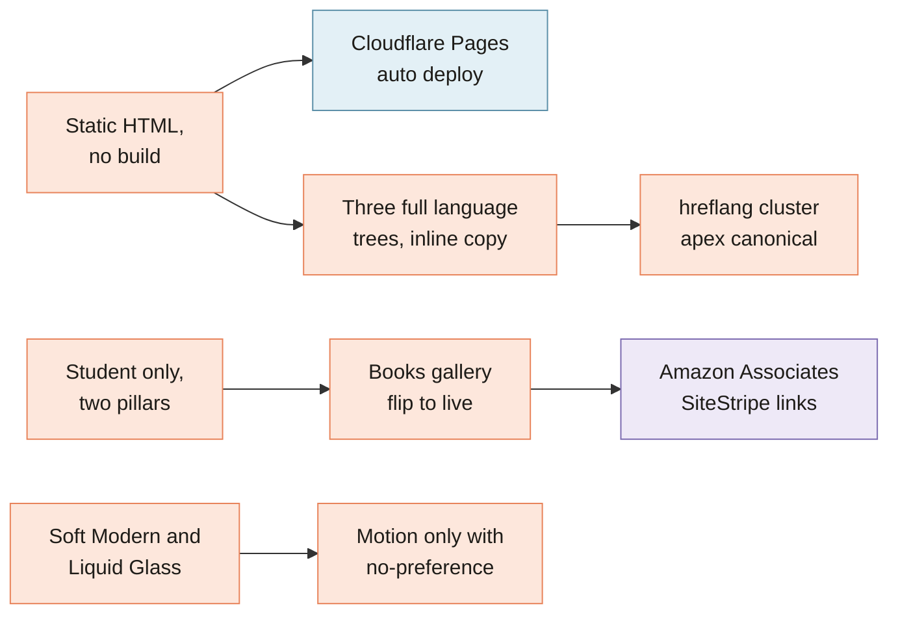

[Home](Home) › Past and future › **Decisions Log**

# Decisions Log

> [!NOTE]
> **At a glance.** The choices that shape this site, each with the date, what was decided, why, and what it costs. Most come straight from the changelog, the roadmap or a design spec. New decisions go at the top of the table and, if they are big, into a spec in `docs/superpowers/specs/` first.

## The log

| Date | Decision | Why | Trade off |
|---|---|---|---|
| 2026-08-23 | Use Amazon's SiteStripe links for buy buttons, not hand built ones (v3.9.2) | Link level reporting in Associates Central needs Amazon's own link parameters | Long URLs in the HTML; regenerate per book |
| 2026-08-23 | Keep JSON-LD `Offer` URLs untagged (v3.9.0) | Structured data describes the product for search engines; the tag is for clicks | Two different links per book to keep in step |
| 2026-08-23 | Amazon look by colour only, no Amazon logo (v3.9.1) | Amazon's brand guidelines restrict their logo without a licence | The button is recognisable but unbranded |
| 2026-07-09 | Books gallery ships as a framework with per card flip to live (v3.7.0) | Titles publish one at a time; the page should look finished at every stage | Each flip is a three language edit |
| 2026-07-09 | Plan direct hardcover sales via Lulu Direct, shape undecided | Print on demand in Ontario, no inventory, keeps the reader's email | Shopify Buy Button costs a monthly fee and a CSP change; a lulu.com link is free but off site |
| 2026-06-18 | All motion inside `prefers-reduced-motion: no-preference`; reveals only hide under a JS added class (v3.6.0) | Reduced motion and no JavaScript visitors must always see a complete page | Slightly more CSS to keep in step |
| 2026-06-15 | Adopt semver tags and timestamped changelog entries (v3.4.1) | One clear record of what shipped when | A small release chore on every merge |
| 2026-06-15 | Real frosted Liquid Glass instead of faux glass (v3.4.0, v3.5.0) | The design called for glass; 85% opaque panels read as flat | Needs a fallback where `backdrop-filter` is missing |
| 2026-06-15 | About hero shows an "at a glance" card, not a large founder photo (v3.3.2) | The value proposition should lead; imagery is illustrative | The founder appears as a small avatar instead |
| 2026-06-15 | Email on iCloud+ Custom Email Domain; keep Titan only for booking (v3.2.0) | Mailbox under an existing family plan; Titan booking still in use | Two senders in SPF and two DKIM keys until Titan retires |
| 2026-06-15 | Keep SPF at `~all`, DMARC at `p=none` for now | A relay on the owner's work inbox softfails SPF; DKIM carries DMARC; reports first, then tighten | Spoofing protection is monitor only until tightened |
| 2026-06-15 | Absolute canonicals and a four way hreflang cluster, apex as the preferred host (v3.1.0) | Relative canonicals and relative sitemap URLs were invalid | Every new page needs four alternates in three places |
| 2026-06-15 | Leave Cloudflare's managed robots.txt on by default | It blocks AI training crawlers without hurting search | The live file can differ from the repo |
| 2026-06-11 | Soft Modern redesign with Fraunces accents on Latin pages only (v3.0.0) | Chosen over Editorial Warmth and Crafted mockups; Arabic has no italic serif | Arabic accents use colour instead |
| 2026-06-08 | Two pillars, Consulting and Books, and drop institution and employer services (v2.0.0) | Focus on students and on the founder's writing, one theme of transition and belonging | The B2B pages and imagery were retired |
| 2026-06-08 | Rename Services to Consulting, with 301s from old URLs | The page now holds student consulting only | Redirect rules to keep forever |
| 2026-05-28 | Static HTML on Cloudflare Pages with no build step | A small marketing site; nothing to install, update or break | Copy, nav and scripts are duplicated by hand |
| 2026-05-28 | Translations inline, one folder per language, translated French slugs | Native feeling URLs for French readers; no tooling | Every change is three edits; slug table to remember |
| 2026-05-28 | Accept that repo docs are publicly served by Pages | Pages has no ignore list; nothing in the docs is secret | Never put private material in the repo |
| 2025 to 2026 | Retire WordPress for static files | WordPress was heavy for a brochure site | No admin panel for non technical edits |

## Decisions still open

- How to sell hardcovers: on site Shopify button or a link to lulu.com.
- What replaces the Titan booking page, and when.
- Whether to show a booking or contact form on the site at all (today there is none).

## Related pages

- [Project History](Project-History)
- [Release History](Release-History)
- [Roadmap](Roadmap)

**Last checked:** 2026-11-09, against `CHANGELOG.md`, `ROADMAP.md` and the specs at `6c632f0`.

Sources

- `CHANGELOG.md` entries v2.0.0 to v3.9.2
- `ROADMAP.md`, all sections
- `docs/superpowers/specs/`: two pillar restructure, Soft Modern, Liquid Glass, character and charisma, books gallery
- `CLAUDE.md`, WordPress provenance and documentation conventions

