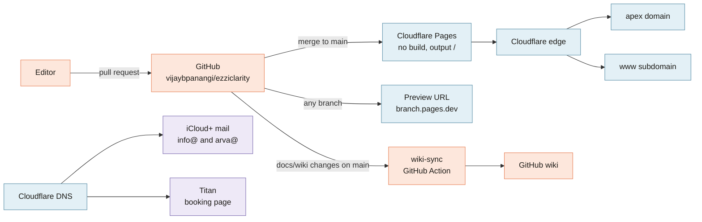

[Home](Home) › Working on it › **Deployment**

# Deployment

> [!NOTE]
> **At a glance.** The site is hosted on **Cloudflare Pages**, connected to this GitHub repo. A push to `main` publishes the repo root to `ezziclarity.ca` and `www.ezziclarity.ca` in about thirty seconds; there is no build command. Every branch also gets a preview URL. DNS and the domain are on Cloudflare too. Email runs on **iCloud+ Custom Email Domain**, with **Titan** kept only for the booking page. The wiki is published separately by the `wiki-sync` GitHub Action.

## Cloudflare Pages settings

These live in the Cloudflare dashboard, not in the repo:

| Setting | Value |
|---|---|
| Framework preset | None |
| Build command | empty |
| Build output directory | `/` (repo root) |
| Production branch | `main` |
| Custom domains | `ezziclarity.ca`, `www.ezziclarity.ca` |
| Environment variables | none |

There is no `wrangler` file and no GitHub deploy workflow; Cloudflare's own GitHub integration does the work. The only workflow in the repo is `wiki-sync`, which never touches the website.

## What a deploy looks like

1. A pull request is merged into `main`.
2. Cloudflare clones the commit, finds nothing to build, and uploads changed files to its edge.
3. Both custom domains serve the new version; `_redirects` rules apply at the edge.
4. Check it visually: open the changed pages in all three languages. There are no automated tests.
5. Tag the release and update `CHANGELOG.md` and the README table (see [Editing Workflow](Editing-Workflow#releasing)).

## Previews

Every branch and commit gets its own `*.pages.dev` preview URL, shown in the Cloudflare dashboard and on the pull request. Use it to review a change on a real phone before merging. The Soft Modern redesign was signed off this way.

## Rolling back

- **Fastest:** Cloudflare dashboard, the `ezziclarity` Pages project, Deployments, choose the last good deployment, **Rollback**. It is instant.
- **Cleanest:** `git revert <bad commit>` in a pull request and merge, so `main` matches what is live again.

Do both if needed: roll back first to stop the problem, then revert so the next deploy does not bring it back.

## Domains and DNS

| Record | Purpose |
|---|---|
| Apex and `www` | Managed by Cloudflare Pages custom domains |
| `MX` to `mx01` and `mx02.mail.icloud.com` | iCloud+ mailboxes `info@` and `arva@` |
| `sig1._domainkey` CNAME | iCloud DKIM |
| `titan1._domainkey` TXT | Titan DKIM, for the booking page's emails |
| `apple-domain` TXT | iCloud domain verification; keep it permanently |
| SPF TXT | `v=spf1 include:spf.titan.email include:icloud.com ~all` |
| DMARC TXT | `v=DMARC1; p=none; rua=mailto:info@ezziclarity.ca; fo=1` (monitor only) |

The WordPress.com era SPF include was removed in v3.2.0. Titan stays in SPF only while the Titan booking page is in use; when it is retired, remove both the Titan SPF include and the `titan1` DKIM record together. The DMARC policy is due to tighten from `none` to `quarantine` and then `reject` once reports look clean (see [Roadmap](Roadmap)).

`www` currently serves a 200 rather than redirecting to the apex. Canonicals already name the apex, so this is polish; the redirect rule steps are in [Runbooks](Runbooks#add-the-www-to-apex-redirect).

## Monitoring

Cloudflare's dashboard shows requests, bandwidth and errors. There is no uptime alerting. If that is ever needed, Cloudflare Web Analytics or an external uptime checker are the light options.

## Related pages

- [Runbooks](Runbooks): step by step jobs
- [Site Architecture](Site-Architecture): what gets served
- [Wiki Maintenance](Wiki-Maintenance): how the wiki is published

**Last checked:** 2026-11-09. Live status codes checked with `curl`; DNS values from `ROADMAP.md` and `CHANGELOG.md` v3.2.0 (not re-queried).

Sources

- `CLAUDE.md`, "Build, run, deploy"
- `ROADMAP.md`, "Email setup for the domain" and "www to apex canonical redirect"
- `CHANGELOG.md` v3.2.0 (SPF and DMARC) and v1.0.0 (www custom domain)
- Live: `https://ezziclarity.ca/` and `https://www.ezziclarity.ca/` both 200, served by `cloudflare`
- `.github/workflows/wiki-sync.yml`

