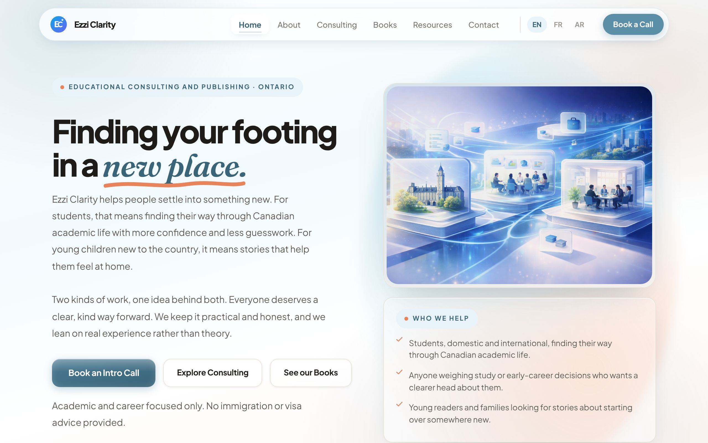
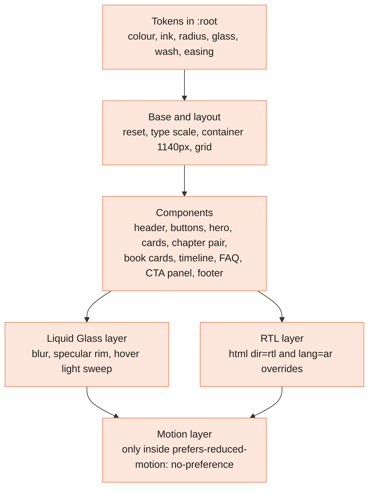

[Home](Home) › How the site works › **Design System**

# Design System

> [!NOTE]
> **At a glance.** The look is **Soft Modern with Liquid Glass**: a white to pale sky and peach page wash, frosted glass cards and a floating frosted header, Plus Jakarta Sans for text, Fraunces italic for small serif accents on English and French headings, and IBM Plex Sans Arabic on Arabic pages. Everything is defined as CSS custom properties in `:root` at the top of `style.css`. Motion is gentle and always switched off for visitors who ask for reduced motion.

## How the layers stack

## Colour tokens

| Family | Tokens | Base value |
|---|---|---|
| Sky blue (primary) | `--sky`, `--sky-mid`, `--sky-dark`, `--sky-light`, `--sky-pale`, `--sky-xpale` | `--sky: #5B8FA8` |
| Warm peach (accent) | `--peach`, `--peach-mid`, `--peach-light`, `--peach-pale`, `--peach-xpale` | `--peach: #E8835A` |
| Cream (neutral) | `--cream`, `--cream-mid`, `--cream-dark`, `--white` | `--cream: #F7F4EE` |
| Ink (text) | `--ink`, `--ink-mid`, `--ink-soft`, `--ink-muted`, `--ink-pale` | `--ink: #1e1c18` |
| Borders | `--border`, `--border-mid` | `#E3DDD0` |
| Glass | `--glass` (55% white), `--glass-strong`, `--glass-border`, `--glass-blur`, `--glass-highlight` | `blur(20px) saturate(1.6)` |
| Shadows | `--shadow-sm`, `--shadow-md`, `--shadow-lg`, `--shadow-btn`, `--shadow-peach`, `--shadow-glass`, `--shadow-glass-lg` | |
| Page wash | `--wash` | white, `--sky-xpale`, white, `--peach-xpale` at 165 degrees |

The diagrams on this wiki borrow the same sky and peach so the docs feel like the site.

## Type

| Family | Where | Loaded by |
|---|---|---|
| **Plus Jakarta Sans** | All body and UI text (`--font-main`) | `@import` at the top of `style.css` |
| **Fraunces** italic | The `<em>` accent in EN and FR `h1` and `h2`, chapter labels, `.serif-lead` (`--font-serif`) | `@import` |
| **IBM Plex Sans Arabic** | All Arabic text, headings and buttons (`--font-arabic`) | `@import` |

All three `@import`s must stay at the very top of the file: an `@import` after any other rule is ignored by browsers. That exact bug once hid a whole font and palette layer; see [Project History](Project-History#the-hidden-override-layer). The base size is 16px.

## Layout tokens

`--container: 1140px`, `--header-h: 88px`, radii `--r-sm` 6px, `--r-md` 10px, `--r-lg` 16px, `--r-xl` 24px, `--r-xxl` 28px and `--r-pill`. Breakpoints are 1024px, 900px and 640px.

## Components

| Component | Class names | Used on |
|---|---|---|
| Floating header | `.site-header`, `.main-nav`, `.nav-link`, `.lang-switch`, `.header-cta` | Every page |
| Mobile drawer | `.nav-toggle`, `.mobile-nav`, `.mobile-cta` | Every page |
| Buttons | `.btn-primary`, `.btn-secondary`, `.btn-lg` | Everywhere |
| Hero and its card | `.hero`, `.hero-copy`, `.hero-card` | Home, About |
| Chips and eyebrows | `.eyebrow`, `.chapter-label`, `.lang-chip`, `.svc-pill` | Everywhere |
| Cards | `.card`, `.service-card`, `.quote-card` | Most pages |
| Chapter pair | `.chapter-pair`, `.chapter-card` | Home |
| About columns | `.about-narrative`, `.about-founder-grid`, `.founder-card`, `.founder-id` | About |
| Book cards | `.book-card`, `.book-cover`, `.book-cta` | Books |
| Process timeline | `.process`, `.process-step`, `.process-number` | Consulting |
| FAQ | `.faq` | Consulting |
| CTA panel | `.section-cta`, `.section-cta-inner` | End of most pages |
| Gateway | `.gateway-wrap`, `.gateway-card`, `.gateway-actions` | `/` and 404 |

Section banner comments (`/* ===== */`) group the file: HEADER, BUTTONS, HERO, CARDS, CHAPTER PAIR, ABOUT, LIQUID GLASS (bold), LIQUID GLASS (maximal), SERVICE CARDS, BOOK GALLERY, PROCESS STEPS, FAQ, CONTACT, FOOTER, LANGUAGE GATEWAY PAGE, RTL SUPPORT, RESPONSIVE, MOTION, and CHARACTER & CHARISMA. Search for the banner instead of scrolling.

## Liquid Glass

Glass surfaces (`.card`, `.quote-card`, `.service-card`, `.contact-form`, `.timeline-item`, `.faq`, `.chapter-card`, `.about-col`, `.hero-card`, `.process-step`) share one rule: a 55% white fill, `backdrop-filter: var(--glass-blur)` and the specular rim from `--glass-highlight`. Soft sky and peach colour pools on fixed `body::before` and `body::after` layers give the frost something to bend, and they drift slowly. Nav links and buttons get the same glass finish, and a diagonal light sweep crosses cards and buttons on hover. Where `backdrop-filter` is not supported, an `@supports not` block makes the surfaces nearly opaque so text stays readable.

## Motion

Introduced in v3.6.0 and strengthened in v3.6.1, all in CSS:

- the peach swash under the italic heading accent draws itself;
- the home hero assembles in a staggered rise;
- the logo settles in with a small bounce and tilts on hover;
- checklist ticks draw themselves with a clip path wipe;
- cards lift with a faint peach edge glow, and buttons press with a spring;
- scroll reveals fade sections in as they enter view.

**The rule to keep:** every entrance or continuous animation lives inside `@media (prefers-reduced-motion: no-preference)`, and a JavaScript reveal only hides an element when a JS added `.reveal` ancestor exists. Visitors with reduced motion, and visitors without JavaScript, always get a complete, still page.

## Symmetry and balance

Grids divide evenly (three services, three books, nine resources as three by three), cards in a row share a height, and buttons pin to the bottom of cards so they line up. Keep that balance when you add items: four books would read better as two by two, or as a centred last row, than as three plus an orphan.

## Related pages

- [Languages and RTL](Languages-and-RTL): how the RTL layer adjusts components
- [Books and Buy Links](Books-and-Buy-Links): book card details
- [Release History](Release-History): v3.0.0, v3.4.0, v3.5.0, v3.6.0
- Specs: [Soft Modern](https://github.com/vijaybpanangi/ezziclarity/blob/main/docs/superpowers/specs/2026-06-11-soft-modern-redesign-design.md), [Liquid Glass](https://github.com/vijaybpanangi/ezziclarity/blob/main/docs/superpowers/specs/2026-06-15-liquid-glass-design.md), [Character and charisma](https://github.com/vijaybpanangi/ezziclarity/blob/main/docs/superpowers/specs/2026-06-18-character-charisma-design.md)

**Last checked:** 2026-11-09, against `style.css` at `6c632f0`.

Sources

- `style.css` lines 1 to 90 (`@import`s and `:root` tokens) and the section banners listed above
- `style.css` media queries: 1024px, 900px, 640px, nine `prefers-reduced-motion` blocks
- `CLAUDE.md`, "Stylesheet" section
- `CHANGELOG.md` v3.0.0, v3.4.0, v3.5.0, v3.6.0, v3.6.1
- Design specs in `docs/superpowers/specs/`

