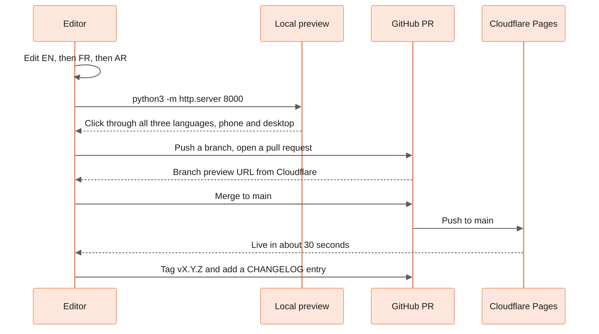

[Home](Home) › Working on it › **Editing Workflow**

# Editing Workflow

> [!NOTE]
> **At a glance.** There is no CMS. To change the site you edit HTML or CSS in the repo, preview it locally with `python3 -m http.server 8000`, open a pull request, and merge to `main`, which deploys within about thirty seconds. Most copy changes are **three edits**, one per language. Anything bigger than copy goes through brainstorm, spec, plan, then build, with the spec and plan saved in `docs/superpowers/`. Every release gets a semver tag and a `CHANGELOG.md` entry.

## Editing copy

1. Open the page in one language, for example `en/about/index.html`, and make the change without disturbing the markup around it.
2. Open its siblings (`fr/a-propos/index.html`, `ar/about/index.html`) and make the translated change. Use the slug table in [Languages and RTL](Languages-and-RTL).
3. If the page title or description changed, the JSON-LD `WebPage` node on that page repeats them; update it too.
4. Preview locally and click through each language, at desktop and phone width.
5. Commit with a clear message. If a change is deliberately English only, say so in the message.

## Editorial guidelines

- **Warm, plain and honest.** Short sentences, concrete verbs, practical next steps. No superlatives.
- **Keep the disclaimer** wording identical in meaning in every language.
- **Never invent facts.** Credentials, prices, dates and book details must match a real source (the founder, Amazon, the registry). The SEO pass deliberately reused existing copy rather than writing new claims.
- **Arabic and French are first class.** If you cannot translate well, flag the string for a native speaker instead of shipping a guess.
- **Balance the layout.** Add items in numbers that keep rows complete (see [Design System](Design-System#symmetry-and-balance)).

## Adding a page

Say you want `/en/case-studies/`:

1. **Create the file** by copying a similar inner page, for example `en/consulting/index.html`.
2. **Fix relative paths** for depth 2: `../../style.css`, `../../assets/images/...`, and `../about/index.html` style nav links.
3. **Update the nav** on every page in that language, in both `.main-nav` and `.mobile-nav`, and mark the new link active on the new page.
4. **Create the siblings** in French (with a translated slug, for example `etudes-de-cas`) and Arabic (English slug, `dir="rtl"`), and update their navs.
5. **Language switcher:** point the new page's `.lang-switch` at its siblings, and theirs back at it.
6. **SEO:** canonical, four `hreflang` links, `og:locale`, a JSON-LD graph, and three new `<url>` entries in `sitemap.xml`. See [SEO](SEO#when-you-add-or-rename-a-page).
7. **Optional:** a short path in `_redirects`.
8. **Check:** `grep -rn 'case-studies' .` and click every link in every language.

To remove or rename a page, do the same in reverse and add a `301` in `_redirects` from the old path.

## Adding a language

Copy a whole tree, translate every visible string and every metadata field, set `lang` and `dir`, add a pill to every language switcher on every page, add a button to the gateway, add six `<url>` entries and a fifth `hreflang` everywhere, and update the docs and this wiki. Plan it as a project with a spec.

## Changing styles

Find the section banner in `style.css`, edit, preview. Use existing tokens (`--sky`, `--peach`, `--ink-muted`, `--glass`) rather than new hex values. Prefer a body class for page specific rules; inline `<style>` blocks are not used. Any new motion goes inside `prefers-reduced-motion: no-preference`.

## Changing the inline script

The mobile menu and reveal script is copied into all 20 HTML files. Change one, test it, then copy the change to every other file and check with `grep`.

## Bigger changes: brainstorm, spec, plan, build

Redesigns, new sections and structural changes follow the workflow in [`docs/superpowers/README.md`](https://github.com/vijaybpanangi/ezziclarity/blob/main/docs/superpowers/README.md):

| Step | Output |
|---|---|
| Brainstorm | Options and a chosen direction |
| Spec | `docs/superpowers/specs/YYYY-MM-DD-<topic>-design.md`: the what and why |
| Plan | `docs/superpowers/plans/YYYY-MM-DD-<topic>.md`: small tasks with exact files and checks |
| Build | Branch, tasks, review, pull request, merge |

## Releasing

Every merge that changes the site is a release:

- **Version:** major for a redesign or identity change, minor for a new feature, patch for a fix, copy or docs.
- **CHANGELOG:** add `## vX.Y.Z, Title (YYYY-MM-DD HH:MM UTC)` at the top, with the time of the merge commit. (Existing headings use a dash separator; new ones can use a comma.)
- **Tag:** `git tag -a vX.Y.Z -m "..." && git push origin vX.Y.Z` on the merge commit.
- **README:** add a row to the release history table.

## Common mistakes

- The wrong number of `../`: the stylesheet or images vanish.
- A French nav block pasted into an Arabic page: links point at `a-propos`.
- A new page whose language switcher still points at the home pages.
- English updated, French and Arabic forgotten.
- A new animation outside the reduced motion guard.

## Related pages

- [Runbooks](Runbooks): step lists for common jobs
- [Deployment](Deployment): what happens after merge
- [AI-Assisted Development](AI-Assisted-Development): working with a coding assistant

**Last checked:** 2026-11-09, against `main` at `6c632f0`.

Sources

- `CLAUDE.md`, "Triplicate maintenance", "Relative paths", "Project documentation conventions" and "Releases and versioning"
- `README.md`, "Working with the site" and "Editing content"
- `docs/superpowers/README.md`
- The 20 HTML files: nav, `.lang-switch` and inline script blocks

