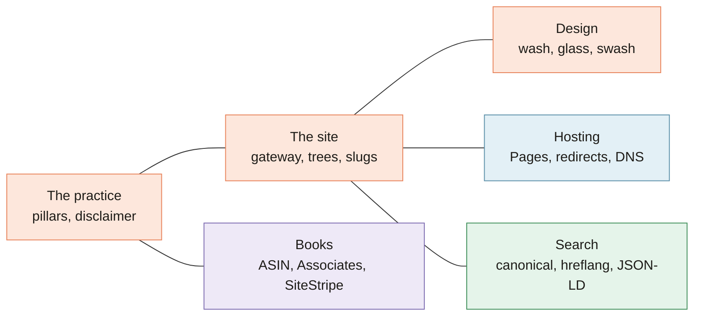

[Home](Home) › Reference › **Glossary**

# Glossary

> [!NOTE]
> **At a glance.** Plain definitions for the words that come up in this repo and its docs, from "flip to live" to "x-default". Terms are grouped by area and listed alphabetically inside each group.

## The practice

| Term | Meaning |
|---|---|
| **Disclaimer** | "Academic and career focused only. No immigration or visa advice provided." Shown in every language. |
| **Pillar** | One of the two halves of the practice: Consulting or Books. |
| **Transition and belonging** | The theme that ties both pillars together: helping people find their footing somewhere new. |
| **Two chapters** | The home page's "We advise" and "We write" pair. |

## The site

| Term | Meaning |
|---|---|
| **Gateway** | The root `/index.html`, where visitors choose a language. |
| **Language tree** | One of `/en/`, `/fr/`, `/ar/`: a full copy of the six pages. |
| **Language switcher** | The EN, FR, AR pills (`.lang-switch`) linking to the same page in other languages. |
| **Relative depth** | How many `../` a page needs to reach `style.css`: none at the root, one in a language home, two in a subpage. |
| **Slug** | The folder name in a URL, for example `a-propos`. French has its own; English and Arabic share English ones. |
| **Triplicate maintenance** | The habit of making each change in all three language trees. |

## Design

| Term | Meaning |
|---|---|
| **Chip** | A small rounded label, used for eyebrows, languages and status. |
| **Light sweep** | The diagonal shine that crosses glass cards and buttons on hover. |
| **Liquid Glass** | The frosted glass surfaces: translucent white, backdrop blur, a bright rim. Also the name of a late 2025 WordPress theme. |
| **Reduced motion** | The operating system setting `prefers-reduced-motion`. When it is on, the site does not animate. |
| **Reveal** | A section fading in as it scrolls into view (`.reveal`, `.is-visible`). |
| **RTL** | Right to left, the reading direction of Arabic, set with `dir="rtl"`. |
| **Soft Modern** | The June 2026 design direction: gradient wash, glass, Fraunces accents. |
| **Swash** | The peach brush stroke drawn under italic heading accents. |
| **Token** | A CSS custom property in `:root`, such as `--sky` or `--glass`. |
| **Wash** | The soft gradient page background, `--wash`. |

## Books

| Term | Meaning |
|---|---|
| **Amazon Associates** | Amazon's affiliate program. Purchases through tagged links earn a small commission. |
| **ASIN** | Amazon's product ID, used in `amazon.ca/dp/<ASIN>`. |
| **Book card** | A `.book-card`: cover, status pill, ages, blurb and buttons. |
| **Flip to live** | Turning a placeholder book card into a live one, following its HTML comment. |
| **KDP** | Kindle Direct Publishing, where the books are published. |
| **Lulu Direct** | A print on demand service considered for hardcovers. |
| **SiteStripe** | Amazon's toolbar for Associates that generates tagged links. |
| **Tracking ID** | `ezziclarity-20`, the Associates tag on every buy link. |

## Hosting and email

| Term | Meaning |
|---|---|
| **Apex** | The bare domain, `ezziclarity.ca`, as opposed to `www`. |
| **Cloudflare Pages** | The static host. Publishes the repo root on every push to `main`. |
| **DKIM, SPF, DMARC** | DNS records that prove email from the domain is genuine. |
| **ECOS** | `ezzi-clarity-os`, a separate repo holding a technical review (REV-1001) of this site. |
| **Preview URL** | A `*.pages.dev` address Cloudflare gives each branch and commit. |
| **`_redirects`** | The file of URL redirect rules that Cloudflare applies at the edge. |
| **Titan** | The service behind the intro call booking page. |

## Search

| Term | Meaning |
|---|---|
| **Canonical** | `<link rel="canonical">`: the one URL a page wants to be indexed as. |
| **hreflang** | Links that tell search engines which pages are translations of each other. |
| **JSON-LD** | Structured data in a `<script type="application/ld+json">` block. |
| **`og:` tags** | Open Graph metadata used for link previews. |
| **x-default** | The hreflang entry for visitors whose language matches none of the others; here, the gateway. |

## Process

| Term | Meaning |
|---|---|
| **Plan** | A step by step build plan in `docs/superpowers/plans/`. |
| **Semver** | Major, minor, patch version numbers on every release tag. |
| **Spec** | A design document in `docs/superpowers/specs/` describing what and why. |
| **wiki-sync** | The GitHub Action that copies `docs/wiki/` to this wiki. |

## Related pages

- [Home](Home)
- [Site Architecture](Site-Architecture)
- [Design System](Design-System)

**Last checked:** 2026-11-09.

Sources

- The other pages of this wiki, and the code and documents they cite
- `CLAUDE.md` and `ROADMAP.md`

