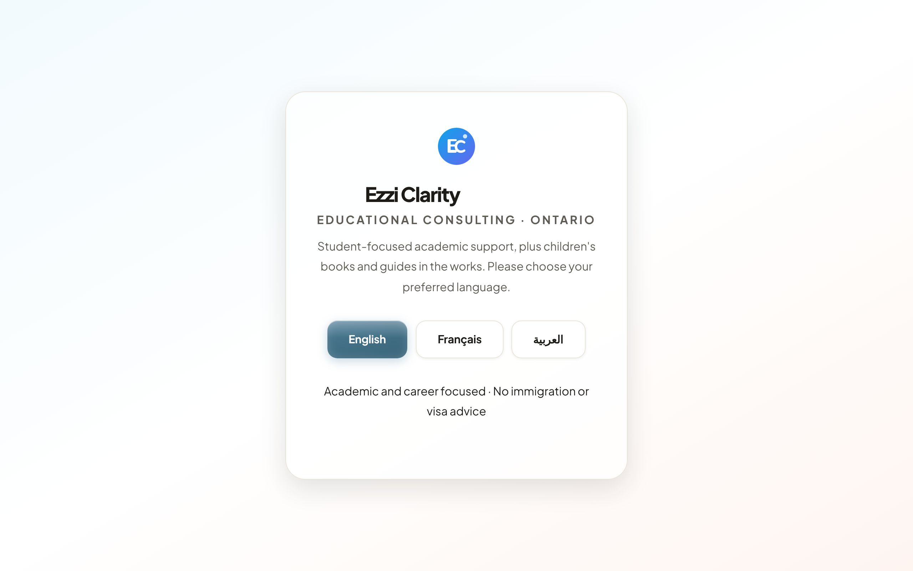
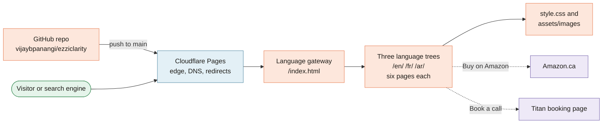

**Home**

# Ezzi Clarity project wiki

*Clear paths. Confident decisions.*

> [!NOTE]
> **At a glance.** Ezzi Clarity is a small educational consulting practice in Southern Ontario with two pillars: student consulting and children's books. This wiki explains the public website at [ezziclarity.ca](https://ezziclarity.ca): what it says, how it is built (hand written HTML and one stylesheet, in English, French and Arabic), how it is deployed (Cloudflare Pages, straight from `main`), and how to change it safely. For the latest release, see [Release History](Release-History).

*The front door: a small gateway where every visitor picks English, French or Arabic.*

## How the whole thing fits together

Colours in every diagram on this wiki follow who owns the box: **peach** is ours (the repo and its pages), **blue** is Cloudflare, **violet** is another third party (Amazon, Titan, Google, iCloud), and **green** is a visitor or a search engine.

## Find your way

| If you want to... | Start here |
|---|---|
| Understand the practice and who the site is for | [About Ezzi Clarity](About-Ezzi-Clarity) |
| See every page in every language | [Pages and Features](Pages-and-Features) |
| Add or update a book and its Amazon link | [Books and Buy Links](Books-and-Buy-Links) |
| Learn how the files are laid out | [Site Architecture](Site-Architecture) |
| Work on French or Arabic, or right to left layout | [Languages and RTL](Languages-and-RTL) |
| Check search and sharing metadata | [SEO](SEO) |
| Change colours, fonts, glass or motion | [Design System](Design-System) |
| Edit copy or add a page | [Editing Workflow](Editing-Workflow) |
| Ship a change, roll one back, or touch DNS and email | [Deployment](Deployment) and [Runbooks](Runbooks) |
| See what shipped and when | [Release History](Release-History) |
| Know why things are the way they are | [Decisions Log](Decisions-Log) and [Project History](Project-History) |
| See what is planned or currently broken | [Roadmap](Roadmap) and [Known Issues](Known-Issues) |
| Look up a term | [Glossary](Glossary) |
| Work with an AI coding assistant on this repo | [AI-Assisted Development](AI-Assisted-Development) |
| Edit this wiki | [Wiki Maintenance](Wiki-Maintenance) |

## The five facts to remember

1. **There is no build.** Every page is a hand written `index.html`; one `style.css` styles all of them. Preview with `python3 -m http.server 8000`.
2. **Everything is in triplicate.** Each page exists in `/en/`, `/fr/` and `/ar/`, and copy changes usually touch all three. French uses its own URL slugs (`a-propos`, `conseil`, `livres`, `ressources`).
3. **Merging to `main` is deploying.** Cloudflare Pages publishes the repo root within about thirty seconds. There is no test suite; checking is visual.
4. **The disclaimer stays.** "Academic and career focused only. No immigration or visa advice provided." appears in every language on purpose. See [About Ezzi Clarity](About-Ezzi-Clarity#the-disclaimer).
5. **This wiki lives in the repo.** Pages are written in `docs/wiki/`, reviewed in a pull request, and published here by the `wiki-sync` workflow. Edits made directly on the wiki tab are overwritten on the next sync. See [Wiki Maintenance](Wiki-Maintenance).

## Where the other documents live

| Document | What it is for |
|---|---|
| [`README.md`](https://github.com/vijaybpanangi/ezziclarity/blob/main/README.md) | The repo front page and the release table |
| [`CLAUDE.md`](https://github.com/vijaybpanangi/ezziclarity/blob/main/CLAUDE.md) | Working notes for coding sessions: conventions and gotchas |
| [`CHANGELOG.md`](https://github.com/vijaybpanangi/ezziclarity/blob/main/CHANGELOG.md) | Everything that has shipped, newest first |
| [`ROADMAP.md`](https://github.com/vijaybpanangi/ezziclarity/blob/main/ROADMAP.md) | Everything that has not shipped yet |
| [`docs/superpowers/`](https://github.com/vijaybpanangi/ezziclarity/tree/main/docs/superpowers) | Design specs and implementation plans |
| [`docs/archive/`](https://github.com/vijaybpanangi/ezziclarity/tree/main/docs/archive) | The three earlier versions of the site, kept for history |

**Last checked:** 2026-11-09, against `main` and the live site.

Sources

- Repository tree at `6c632f0`: `index.html`, `en/`, `fr/`, `ar/`, `style.css`, `_redirects`, `sitemap.xml`, `robots.txt`, `404.html`
- `CLAUDE.md`, `README.md`, `CHANGELOG.md`, `ROADMAP.md`
- Live checks on 2026-11-09: `https://ezziclarity.ca/` returns 200; screenshot taken in headless Chromium

