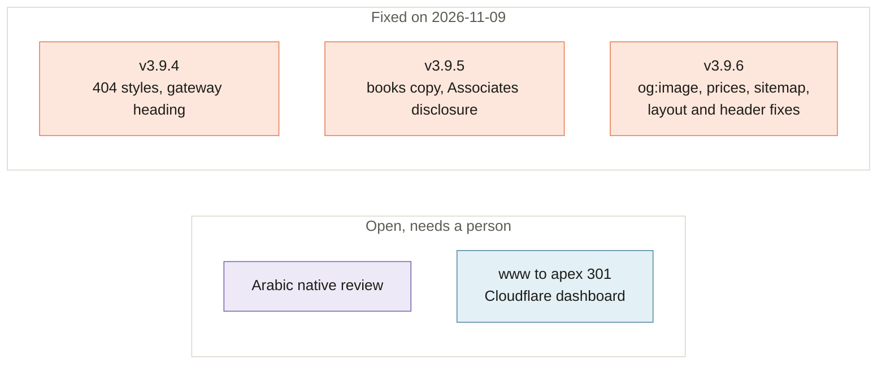

[Home](Home) › Past and future › **Known Issues**

# Known Issues

> [!NOTE]
> **At a glance.** The wiki review on 2026-11-09 found a dozen small problems on the live site and in the code. All the ones a code change can fix shipped the same day, in v3.9.4, v3.9.5 and v3.9.6. Two items remain, and both need a person rather than a code change: the **Arabic native review**, and the **`www` to apex redirect** in the Cloudflare dashboard. When you find a new problem, add it here and to `ROADMAP.md`; when it is fixed, move it to the Fixed table and record it in `CHANGELOG.md`.

## Open

| Issue | Where | What to do |
|---|---|---|
| **Arabic native review pending.** The Arabic copy was written by translation. The checklist from June 2026, with additions from 2026-11-09 (items 17 to 21), still says "awaiting native-speaker review". | `docs/superpowers/specs/arabic-review-checklist.md` | Ask a native speaker to go through the checklist; apply corrections in all affected pages and record the outcome. |
| **`www` serves a copy.** `www.ezziclarity.ca` returns 200 instead of a 301 to the apex. Canonicals already name the apex, so this is polish. Cloudflare Pages cannot redirect a host from `_redirects`. | Cloudflare dashboard | See [Runbooks](Runbooks#add-the-www-to-apex-redirect). |

## Fixed

| Issue | Fixed in |
|---|---|
| 404 page unstyled on nested paths (relative `style.css` and logo); now root-relative | v3.9.4 |
| Gateway and 404 heading about 62px off centre (global `h1` max width without auto margins) | v3.9.4 |
| Books pages, home, footer and gateway still said the books were not out or "in the works" | v3.9.5 |
| No Amazon Associates disclosure on the Books pages | v3.9.5 |
| `og:image` was a relative URL on all 19 pages; now `https://ezziclarity.ca/assets/images/og-ezzi-clarity.png` | v3.9.6 |
| `Book` offers said `USD` with US list prices on amazon.ca links; now `CAD` with the amazon.ca paperback prices checked on 2026-11-09 | v3.9.6 |
| All 19 sitemap `lastmod` dates read 2026-06-15; now 2026-11-09, since every page changed that day | v3.9.6 |
| Gateway small print used an undefined `var(--text-soft)`; now `var(--ink-soft)` | v3.9.6 |
| Home pages 3px wider than a phone screen (the hero's soft blob); the hero now clips horizontally | v3.9.6 |
| Lone student-guide card sat left in a three column grid; a lone item now takes the middle column, and at two columns an odd last card is centred at one column's width (this also centres the third book, service and resource card at tablet widths) | v3.9.6 |
| French header clipped its "Prendre rendez-vous" button between 901 and about 1030px (English between 901 and about 950px); the header now switches to the menu button below 1060px | v3.9.6 |

## Related pages

- [Roadmap](Roadmap)
- [Runbooks](Runbooks)
- [Languages and RTL](Languages-and-RTL#native-review-status)

**Last checked:** 2026-11-09, against the live site and `main` in headless Chromium at widths from 360 to 1440px.

Sources

- Page width sweep (`document.documentElement.scrollWidth`) on the gateway, the three home pages, several inner pages and the 404, at 16 widths from 360 to 1440px
- Grid row measurements on the Books, Consulting, Resources and home pages at 1280, 1000, 800 and 390px
- Amazon.ca product pages for ASINs `B0HG6B8LKB`, `B0HG6FSXYB` and `B0HG5Y7XWM` (paperback, CAD), fetched 2026-11-09
- `docs/superpowers/specs/arabic-review-checklist.md`
- `curl -I https://www.ezziclarity.ca/` (200)

