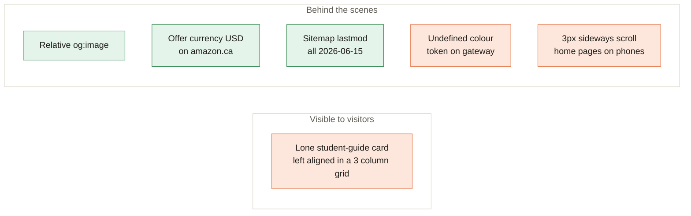

[Home](Home) › Past and future › **Known Issues**

# Known Issues

> [!NOTE]
> **At a glance.** Problems found on the live site and in the code during the wiki review on 2026-11-09. None stops a visitor from reading or booking. The visible ones are fixed: the unstyled nested 404 and the off-centre gateway heading in v3.9.4, and the stale books copy and missing Amazon Associates disclosure in v3.9.5. What remains is mostly behind the scenes, plus the lone student-guide card on the Books pages. Each item says where it lives and how to fix it. When one is fixed, remove it here and record it in `CHANGELOG.md`.

## Visible to visitors

| Issue | Where | Fix |
|---|---|---|
| **Lone student-guide card.** "Practical guides for students" has one card in a three column grid, so it sits at the left with two empty columns beside it, which breaks the site's symmetry. | `en/books/`, `fr/livres/`, `ar/books/` | Centre a short last row (or the single card) until more guides exist. |

## Behind the scenes

| Issue | Where | Fix |
|---|---|---|
| **Relative `og:image`.** Link previews need an absolute image URL; some apps ignore relative ones. | `<head>` of all 19 pages | `https://ezziclarity.ca/assets/images/og-ezzi-clarity.png` |
| **Offer currency.** Each `Book` offer says `"priceCurrency": "USD"` with an amazon.ca link. | JSON-LD on the Books pages | Confirm the Amazon.ca price and use `CAD`, or drop the price fields. |
| **Sitemap dates.** All 19 `<lastmod>` values are 2026-06-15, though the Books pages changed in July and August. | `sitemap.xml` | Update `lastmod` for pages that changed. |
| **Undefined token.** The gateway's small print uses `var(--text-soft)`, which is not defined; it falls back to the inherited colour. | `index.html` | Use `var(--ink-soft)`. |
| **Slight sideways scroll on phones.** At 390px the home pages are 393px wide, most likely from the hero's decorative blob. | `en/`, `fr/`, `ar/` home | Clip the blob (`overflow-x: clip` on the hero) and recheck. |
| **Arabic native review pending.** The checklist from June 2026 still says "awaiting native-speaker review". | `docs/superpowers/specs/arabic-review-checklist.md` | Ask a native speaker; record the outcome in the checklist. |
| **`www` serves a copy.** `www.ezziclarity.ca` returns 200 instead of a 301 to the apex. | Cloudflare dashboard | See [Runbooks](Runbooks#add-the-www-to-apex-redirect). |

## Fixed

| Issue | Fixed in |
|---|---|
| 404 page unstyled on nested paths (relative `style.css` and logo); now root-relative | v3.9.4 |
| Gateway and 404 heading about 62px off centre (global `h1` max width without auto margins) | v3.9.4 |
| Books pages, home, footer and gateway still said the books were not out or "in the works" | v3.9.5 |
| No Amazon Associates disclosure on the Books pages | v3.9.5 |

## Related pages

- [Roadmap](Roadmap): planned work, including these fixes
- [Runbooks](Runbooks)
- [Books and Buy Links](Books-and-Buy-Links)

**Last checked:** 2026-11-09, against the live site (headless Chromium at 1280px and 390px) and `main` at `6c632f0`.

Sources

- Books pages' second grid (one `.book-card`) at 1280px
- `og:image` values in each `<head>`; JSON-LD `Book` offers; `sitemap.xml` `lastmod` values
- `document.documentElement.scrollWidth` of 393 at a 390px viewport on `/en/` and `/ar/`

