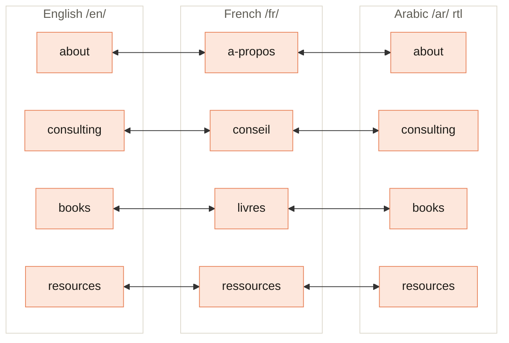
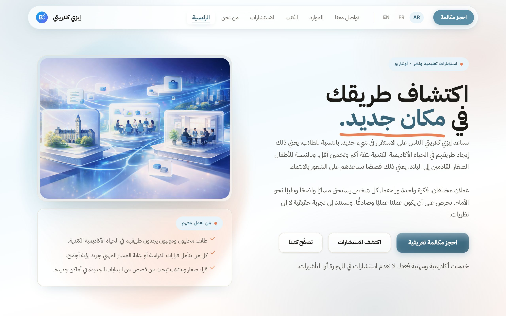

[Home](Home) › How the site works › **Languages and RTL**

# Languages and RTL

> [!NOTE]
> **At a glance.** The site is fully translated into **English**, **French** and **Arabic**, each as its own complete folder of six pages. There is no translation system: every string lives inline in the HTML, so a copy change is three edits. French uses translated URL slugs; English and Arabic share English slugs. Arabic pages are right to left (`<html lang="ar" dir="rtl">`) with their own font, while the header and language switcher stay left to right on purpose.

*Home (`/xx/`) and `contact` use the same slug in all three languages.*

## The three trees

| | English | French | Arabic |
|---|---|---|---|
| `<html>` | `lang="en"` | `lang="fr"` | `lang="ar" dir="rtl"` |
| `og:locale` | `en_CA` | `fr_CA` | `ar` |
| Slugs | English | Translated | English |
| Brand name | Ezzi Clarity | Ezzi Clarity | إيزي كلاريتي |
| Body font | Plus Jakarta Sans | Plus Jakarta Sans | IBM Plex Sans Arabic |
| Heading accent | Fraunces italic | Fraunces italic | Colour only (no italic) |

Brand `aria-label` and `alt` text are translated too, for example "Ezzi Clarity, Home", "Ezzi Clarity, Accueil" and "إيزي كلاريتي، الرئيسية" (shown here without the site's dash separator).

## The language switcher

Every page has a `.lang-switch` with EN, FR and AR pills. Each pill links straight to **the same page** in the other language, and those links are hard coded. When you add or rename a page, update the switcher on that page and on its two siblings. The gateway at `/` offers the same three choices to first time visitors and never guesses.

## How Arabic is laid out

Most of the mirroring comes free from `dir="rtl"`: text aligns right and flex and grid rows run right to left. The `RTL SUPPORT (Arabic)` section of `style.css` adds the rest:

- **Header stays LTR.** `.site-header`, `.main-nav` and `.lang-switch` are set to `direction: ltr`, and the switcher also carries `dir="ltr"` in the HTML, so the EN, FR, AR pills read in a stable order.
- **Lists and ticks move sides.** List padding flips, and the hero card ticks sit on the right.
- **Phone numbers and emails stay LTR.** `tel:` and `mailto:` links, and any text wrapped in `.ltr`, use `unicode-bidi: bidi-override` so numbers do not scramble.
- **Arabic typography.** `html[lang="ar"]` switches to IBM Plex Sans Arabic for body, headings and buttons, and sets `letter-spacing: 0`, because letter spacing breaks joined Arabic script.
- **Accents by colour, not italics.** Arabic has no italic serif, so `h1 em` and `h2 em` become bold in `--sky-dark` instead of Fraunces italic. The peach underline swash still draws, mirrored.
- **Motion mirrors.** Directional effects such as the hover light sweep and the process timeline connector are flipped under `html[dir="rtl"]`.

## Native review status

The Arabic copy written during the June 2026 restructure was translated, not written by a native speaker. `docs/superpowers/specs/arabic-review-checklist.md` lists the pages and a few phrases to confirm (for example the home headline wording and the nav term for Consulting). Its status still reads "awaiting native-speaker review". Treat Arabic copy changes with the same care, and ask a native speaker when you can. French is maintained the same way; the founder's French is listed as "working".

## Adding a fourth language

It is a real project, not an afternoon: copy a full tree, translate every visible string and metadata field, set `lang` (and `dir` if needed), add a pill to every switcher on every page and a button on the gateway, add six new `<url>` entries to `sitemap.xml`, add a fifth `hreflang` to every page, and update the docs. See [Editing Workflow](Editing-Workflow#adding-a-language).

## Related pages

- [SEO](SEO): hreflang and locales in detail
- [Design System](Design-System): fonts and tokens
- [Editing Workflow](Editing-Workflow): the three file edit routine

**Last checked:** 2026-11-09, against `main` at `6c632f0`; Arabic screenshots from the live site.

Sources

- `ar/about/index.html` line 2 (`lang="ar" dir="rtl"`) and line 149 (`.lang-switch dir="ltr"`)
- `style.css` "RTL SUPPORT (Arabic)" section, about lines 1683 to 1727
- `style.css` `.ltr` rule (line 1467)
- `docs/superpowers/specs/arabic-review-checklist.md`
- `CLAUDE.md`, "Per-language URL slugs" and "Per-language HTML attributes"

