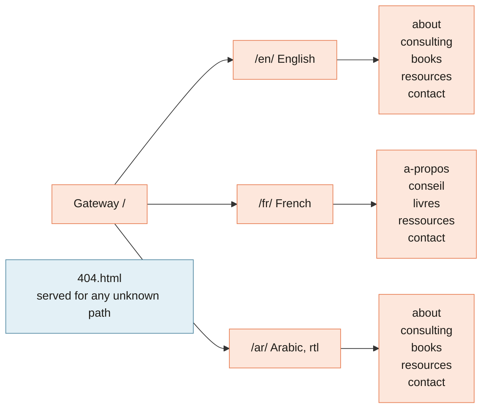
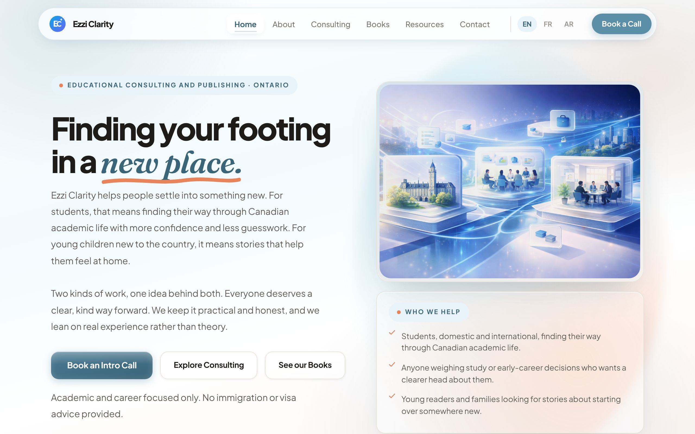
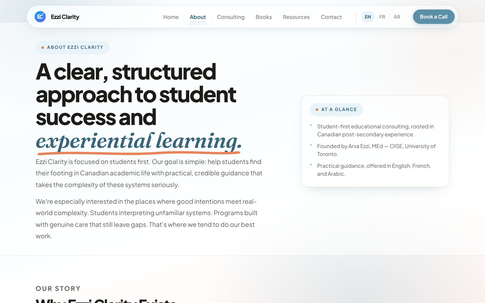
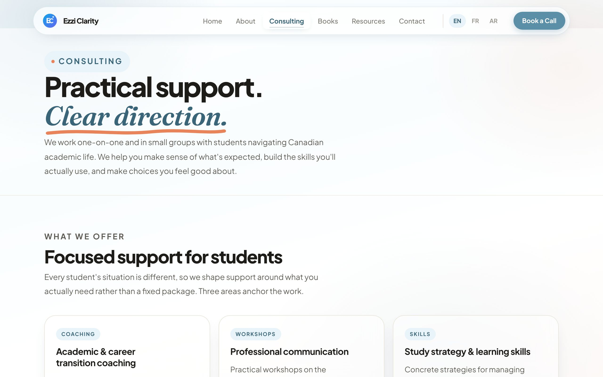
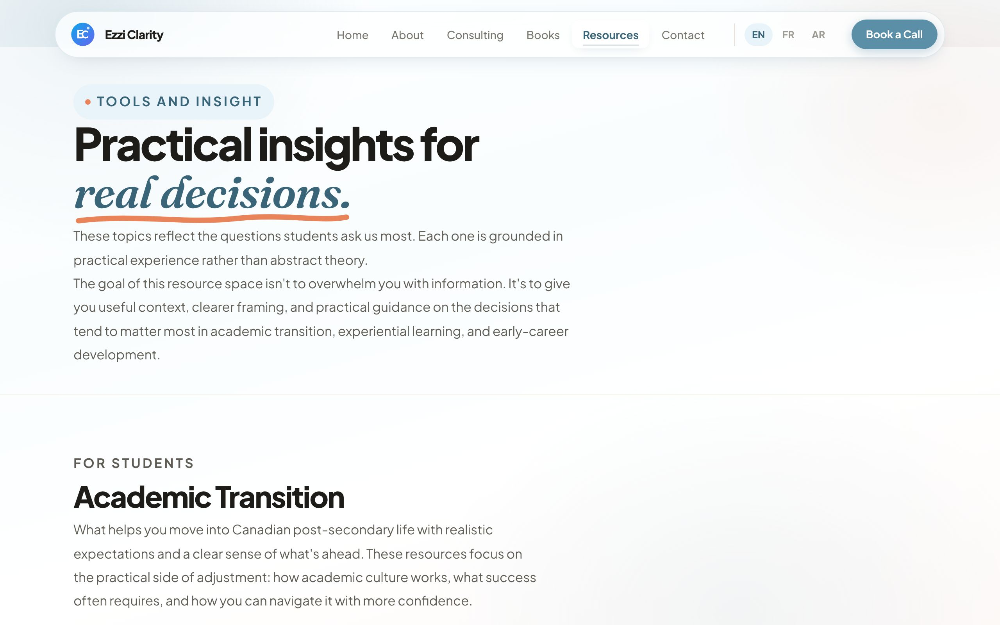
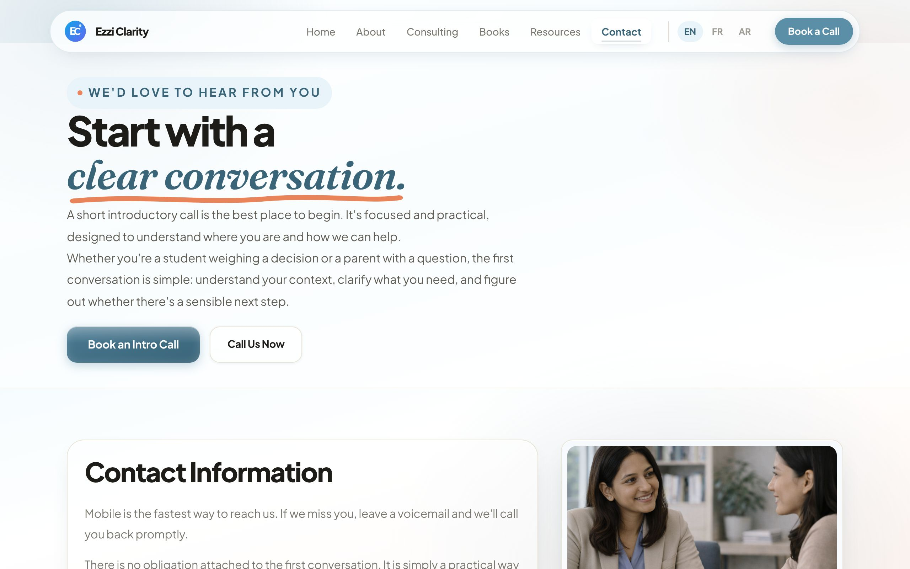
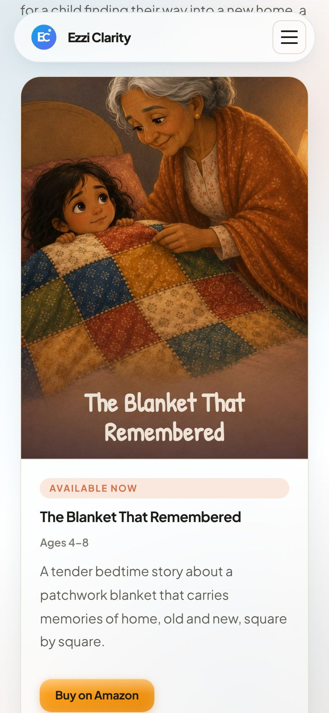
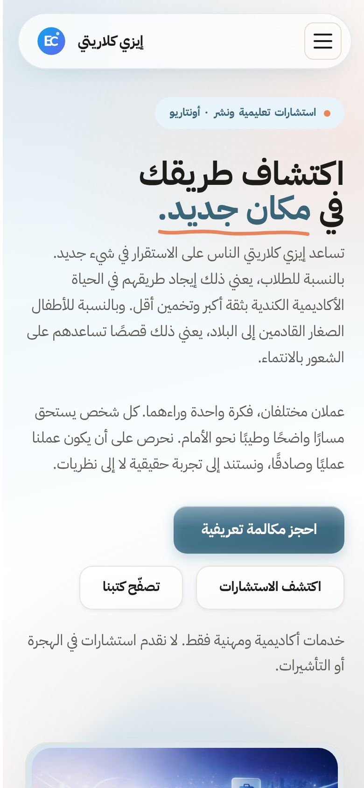

[Home](Home) › The practice › **Pages and Features**

# Pages and Features

> [!NOTE]
> **At a glance.** The site has **20 HTML files**: a language gateway, six pages in each of three languages (18 in all), and a 404 page. Every language has the same six pages in the same order: Home, About, Consulting, Books, Resources, Contact. Shared features on every page: a floating frosted header with a language switcher, a mobile drawer menu, scroll reveals that respect reduced motion, a footer with the disclaimer, and structured data for search engines.

## Page map

| Page | English | French | Arabic | What it is for |
|---|---|---|---|---|
| Gateway | `/` | `/` | `/` | Pick a language |
| Home | [`/en/`](https://ezziclarity.ca/en/) | [`/fr/`](https://ezziclarity.ca/fr/) | [`/ar/`](https://ezziclarity.ca/ar/) | Introduce both pillars |
| About | [`/en/about/`](https://ezziclarity.ca/en/about/) | [`/fr/a-propos/`](https://ezziclarity.ca/fr/a-propos/) | [`/ar/about/`](https://ezziclarity.ca/ar/about/) | Story, founder, principles |
| Consulting | [`/en/consulting/`](https://ezziclarity.ca/en/consulting/) | [`/fr/conseil/`](https://ezziclarity.ca/fr/conseil/) | [`/ar/consulting/`](https://ezziclarity.ca/ar/consulting/) | Services, process, questions |
| Books | [`/en/books/`](https://ezziclarity.ca/en/books/) | [`/fr/livres/`](https://ezziclarity.ca/fr/livres/) | [`/ar/books/`](https://ezziclarity.ca/ar/books/) | Book gallery and buy links |
| Resources | [`/en/resources/`](https://ezziclarity.ca/en/resources/) | [`/fr/ressources/`](https://ezziclarity.ca/fr/ressources/) | [`/ar/resources/`](https://ezziclarity.ca/ar/resources/) | Nine short articles for students |
| Contact | [`/en/contact/`](https://ezziclarity.ca/en/contact/) | [`/fr/contact/`](https://ezziclarity.ca/fr/contact/) | [`/ar/contact/`](https://ezziclarity.ca/ar/contact/) | Book a call, phone, email, map |

## Page by page

### Gateway

A single centred card with the logo, the line "Educational consulting · Ontario", a one sentence introduction, three buttons (English, Français, العربية) and the disclaimer. It does not guess the visitor's language; it asks.

### Home

- **Hero:** "Finding your footing in a *new place*." with three buttons (book a call, explore consulting, browse the books) and an "at a glance" card listing who the practice works with.
- **What working with us feels like:** three principles.
- **Two chapters:** *We advise* (consulting) and *We write* (books), side by side on wide screens.
- **Closing call to action:** "Let's talk about where you are."

### About

"Why Ezzi Clarity exists", then "Meet Arva Ezzi" as a balanced two column split (an identity card with a small portrait, language chips and contact, beside her background), then three principles and a call to action.

### Consulting

Three service cards, the four step process as a vertical timeline, a short set of common questions, and a call to action.

### Books

See [Books and Buy Links](Books-and-Buy-Links) for the full story. The page has an introduction to the children's series, a "Now available" grid of three live books with **Buy on Amazon** buttons, a "Practical guides for students" section with one guide in development, and a closing call to action.

### Resources

Nine short articles in three groups of three, so each row is complete:

| Academic Transition | Experiential Learning | Early Career Development |
|---|---|---|
| Understanding Academic Expectations in Canada | What Co-op and Internships Can Do for You | Getting Ready for the Workforce |
| Building Sustainable Study Strategies | Making the Most of a Placement | Sizing Up a Workplace Honestly |
| Working With Feedback | Turning Work Experience into Growth | Having Honest Career Conversations |

### Contact

There is **no form**. Visitors book through the Titan booking page (`book.titan.email/ezziclarity/intro`), call, or email `info@ezziclarity.ca`. The page also lists the business addresses and embeds a Google Map of the Waterloo office.

### 404

A plain card with "Page not found", a link to the English site and a link back to the gateway. It currently loses its styling on nested paths; see [Known Issues](Known-Issues).

## Features shared by every page

| Feature | How it works |
|---|---|
| Floating header | A frosted pill with logo, six nav links, the EN, FR and AR switcher, and a **Book a Call** button |
| Mobile menu | A hamburger toggles `.mobile-nav`; Escape closes it. The script is inline and copied into every page |
| Language switcher | `.lang-switch` links straight to the same page in the other languages (hard coded per page) |
| Scroll reveals | An `IntersectionObserver` adds `.is-visible` as sections enter view. Without JavaScript, or with reduced motion, everything is simply visible |
| Disclaimer | In the hero or footer of every page, in every language |
| Structured data | A JSON-LD `@graph` on every page; see [SEO](SEO) |
| Accessibility scaffolding | Skip link, `aria-label`, `aria-expanded`, `aria-current`, empty `alt` on decorative images |

On a phone the header collapses to the logo and a menu button, and columns stack:

| English Books, phone width | Arabic Home, phone width |
|---|---|
|  |  |

## Related pages

- [Languages and RTL](Languages-and-RTL): why the French slugs differ and how Arabic mirrors
- [Design System](Design-System): the components named above
- [Editing Workflow](Editing-Workflow): how to change any of these pages

**Last checked:** 2026-11-09. Screenshots taken from the live site in headless Chromium the same day.

Sources

- All 20 HTML files at `6c632f0`; headings extracted with `grep`
- `en/contact/index.html` lines 220 to 345: booking link, phone, email, map
- `en/resources/index.html`: the nine article titles
- `CLAUDE.md`, sections "Mobile navigation" and "Maintenance notes"
- Live screenshots: `/`, `/en/`, `/en/about/`, `/en/consulting/`, `/en/resources/`, `/en/contact/`, `/en/books/`, `/ar/`

