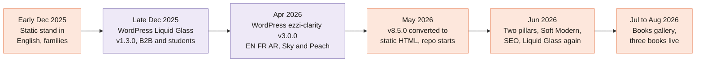

[Home](Home) › Past and future › **Project History**

# Project History

> [!NOTE]
> **At a glance.** The site has had four lives: an English only **static stand in** (early December 2025), a WordPress **"Liquid Glass"** theme (late December 2025), a trilingual WordPress theme that grew from **v3.0.0 to v8.5.0** (spring 2026), and today's **plain static site** in this repo (from May 2026), which has since been restructured around two pillars, redesigned, and given a books gallery. Source files for the three earlier versions are preserved in [`docs/archive/`](https://github.com/vijaybpanangi/ezziclarity/tree/main/docs/archive).

*Peach eras were static files we hosted; violet eras ran on WordPress.com.*

## How sure we are

Each section says where its facts come from. **Archive** means the preserved source files in `docs/archive/`; **git** means this repo's history; **reconstructed** means pieced together from notes, plausible but not provable.

## Q4 2025: the practice is founded

*Archive.* Ezzi Clarity Educational Consulting Services Inc. was incorporated in British Columbia and registered to do business in Ontario, with its working office in Waterloo. The founder is Arva Ezzi, MEd (OISE, University of Toronto), with prior roles supporting students at the University of Toronto and York University. The domain `ezziclarity.ca` is registered through Cloudflare.

## Early December 2025: the static stand in

*Archive: [`docs/archive/2025-12-static-standin/`](https://github.com/vijaybpanangi/ezziclarity/tree/main/docs/archive/2025-12-static-standin).*

A temporary English only site with a yellow "temporary stand in" banner. It spoke to families: Students, Parents and Families, Adult Learners. Tagline "Less Noise. More Signal.", Inter and Playfair Display fonts, a sky to indigo gradient, and full dark mode.

## Late December 2025: WordPress "Liquid Glass"

*Archive: [`docs/archive/2025-12-28-wordpress-liquid-glass-staging-v4/`](https://github.com/vijaybpanangi/ezziclarity/tree/main/docs/archive/2025-12-28-wordpress-liquid-glass-staging-v4).*

Within about three weeks a custom WordPress.com theme, *Ezzi Clarity, Liquid Glass (Staging v4)*, version 1.3.0, had replaced it. The audience had pivoted to **Students, Institutions and Employers**, with a service tier for each. The look was light mode glass: translucent surfaces with backdrop blur, a royal blue accent, and Apple system fonts winning the cascade over Roboto. Much of today's class vocabulary (`.service-card`, `.hero-card`, `.checklist`, `.faq`, `.section-cta`, `.process-step`) and many images date from this theme.

## January to April 2026: the ezzi-clarity theme

*Archive: [`docs/archive/2026-04-06-wordpress-v3-0-0/`](https://github.com/vijaybpanangi/ezziclarity/tree/main/docs/archive/2026-04-06-wordpress-v3-0-0).*

By 6 April 2026 the theme was simply *Ezzi Clarity* v3.0.0 and much of today's base was in place: Plus Jakarta Sans, the Sky, Peach and Cream palette, a 1140px container, and full **English, French and Arabic** trees with French slugs and right to left Arabic. Glass survived only on the header. The tagline was still "Less Noise. More Signal."

## April to May 2026: v8.5.0 and the move to static

*Reconstructed, bracketed by the April archive and the first commits.*

The theme moved quickly to v8.5.0. The tagline became **"Clear paths. Confident decisions."** and the contact page was simplified. The final theme was then converted to plain HTML and CSS, and uploaded to this repo on 2026-05-26. WordPress, PHP and plugins were dropped; the design, copy, images and three language structure were kept.

## Late May 2026: the repo grows up

*Git.* Docs were added (`README`, `CLAUDE.md`, `CHANGELOG`, `ROADMAP`, `docs/superpowers/`), WordPress leftovers were scrubbed (the theme header in `style.css`, a `static-site` body class, orphan selectors), `www.ezziclarity.ca` was connected, the first nine page wiki was written, and **v1.0.0** was tagged on 2026-05-28.

## June 2026: two pillars and Soft Modern

*Git.*

- **v2.0.0, 8 June:** the practice became **student only** with two pillars, Consulting and Books, under the theme of transition and belonging. Services was renamed Consulting (with redirects), the Books pages were added, and institution and employer copy was removed.
- **v3.0.0, 11 June:** the **Soft Modern** redesign: gradient wash, glass cards, a floating frosted header, Fraunces accents, IBM Plex Sans Arabic, the chapter pair, the consulting timeline and scroll reveals. Copy and URLs did not change.
- **15 June:** the SEO foundation (v3.1.0), email on iCloud+ (v3.2.0), the founder on the About page (v3.3.x), real Liquid Glass (v3.4.0, v3.5.0) and semver tagging (v3.4.1).
- **v3.6.0 and v3.6.1, 18 June:** the motion pass.

### The hidden override layer

*Git, commit `cad51e7`.* During the redesign a `V8.5 REVAMP OVERRIDES` block was found deep in `style.css`. It redefined the palette as navy, teal and coral, and its `@import` for the Sora font sat mid file, where browsers ignore it. So from the static conversion until 11 June the live site had actually shown the **navy, teal and coral** palette, not the documented Sky and Peach. The block was removed, and the rule "all `@import`s at the very top" is now written into the docs.

## July to August 2026: books

*Git.* The books gallery framework shipped in v3.7.0 (9 July). On 23 August the first three picture books went live (v3.8.0), the Amazon Associates tag was added (v3.9.0), the buy button got its orange finish (v3.9.1), and links moved to SiteStripe (v3.9.2).

## Paths not taken

| Idea | What happened |
|---|---|
| Liquid Glass as the whole identity (2025) | Retired in early 2026 as too cool for the practice's tone; glass returned in June 2026 as a material inside the warmer Soft Modern look |
| A blog | Considered several times; deferred because of uncertain cadence and the risk of a stale section |
| A client portal or on site scheduling | Booking stays on Titan's hosted page |
| Dark mode | Present in the 2025 stand in, not carried into later versions |
| Institution and employer services | Dropped in v2.0.0 |

## Related pages

- [Release History](Release-History)
- [Decisions Log](Decisions-Log)
- [Design System](Design-System)

**Last checked:** 2026-11-09, against `docs/archive/`, `CHANGELOG.md` and `git log` at `6c632f0`.

Sources

- `docs/archive/2025-12-static-standin/` and its README
- `docs/archive/2025-12-28-wordpress-liquid-glass-staging-v4/` (`style.css` theme header and templates)
- `docs/archive/2026-04-06-wordpress-v3-0-0/` (`style.css` and templates)
- `CHANGELOG.md`, "Earlier (Q4 2025 to Q2 2026)" and v1.0.0 to v3.9.2
- `git log` from `97b0df8` (2026-05-26, "Initial upload") onward; commit `cad51e7`
- The previous version of this page (2026-06-15), condensed and rechecked

