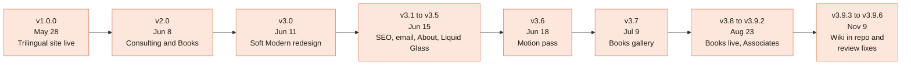

[Home](Home) › Past and future › **Release History**

# Release History

> [!NOTE]
> **At a glance.** 28 releases from **v1.0.0** (2026-05-28, the trilingual static site goes live) to **v3.9.6** (2026-11-09, the last review fixes). Major versions mark identity shifts: v2 is the two pillar restructure, v3 the Soft Modern redesign. Every release is a semver tag on its merge commit with a timestamped entry in [`CHANGELOG.md`](https://github.com/vijaybpanangi/ezziclarity/blob/main/CHANGELOG.md), which has the full notes.

## Every release

Times are UTC, from the merge commit. PR links point at `vijaybpanangi/ezziclarity`.

| Version | When | Change | Summary |
|---|---|---|---|
| `v3.9.6` | 2026-11-09 | [PR 29](https://github.com/vijaybpanangi/ezziclarity/pull/29) | Review fixes: absolute og:image, CAD prices, sitemap dates, grid and header symmetry, hero overflow |
| `v3.9.5` | 2026-11-09 20:34 | [PR 28](https://github.com/vijaybpanangi/ezziclarity/pull/28) | Books copy brought up to date in three languages; Amazon Associates disclosure |
| `v3.9.4` | 2026-11-09 20:28 | [PR 26](https://github.com/vijaybpanangi/ezziclarity/pull/26) | 404 page styled on every path, gateway heading centred, doc fixes |
| `v3.9.3` | 2026-11-09 20:16 | [PR 25](https://github.com/vijaybpanangi/ezziclarity/pull/25) | The wiki moves into `docs/wiki/` with a `wiki-sync` workflow |
| `v3.9.2` | 2026-08-23 22:27 | [PR 24](https://github.com/vijaybpanangi/ezziclarity/pull/24) | Buy links switched to the SiteStripe generated links |
| `v3.9.1` | 2026-08-23 22:10 | [PR 23](https://github.com/vijaybpanangi/ezziclarity/pull/23) | Buy on Amazon button styled in a warm orange |
| `v3.9.0` | 2026-08-23 22:00 | [PR 22](https://github.com/vijaybpanangi/ezziclarity/pull/22) | Amazon Associates tag `ezziclarity-20` on all nine buy buttons |
| `v3.8.0` | 2026-08-23 21:18 | [PR 20](https://github.com/vijaybpanangi/ezziclarity/pull/20) | First three books go live with covers, buy links and `Book` data |
| (untagged) | 2026-08-23 | [PR 21](https://github.com/vijaybpanangi/ezziclarity/pull/21) | Buy button pinned to the bottom of each book card |
| (untagged) | 2026-08-04 | [PR 19](https://github.com/vijaybpanangi/ezziclarity/pull/19) | Docs: governance link to the external technical review |
| `v3.7.0` | 2026-07-09 17:58 | [PR 18](https://github.com/vijaybpanangi/ezziclarity/pull/18) | Books gallery: book cards with a flip to live pattern |
| `v3.6.1` | 2026-06-18 22:48 | [PR 17](https://github.com/vijaybpanangi/ezziclarity/pull/17) | Motion made noticeable: bigger hero rise, ticks that draw |
| `v3.6.0` | 2026-06-18 22:16 | [PR 16](https://github.com/vijaybpanangi/ezziclarity/pull/16) | Character and charisma: swash, living background, tactile cards |
| `v3.5.1` | 2026-06-15 19:21 | [PR 14](https://github.com/vijaybpanangi/ezziclarity/pull/14) | Docs: release history table |
| `v3.5.0` | 2026-06-15 18:59 | [PR 13](https://github.com/vijaybpanangi/ezziclarity/pull/13) | Maximal Liquid Glass: glassy nav and buttons, hover light sweep |
| `v3.4.1` | 2026-06-15 17:46 | [PR 12](https://github.com/vijaybpanangi/ezziclarity/pull/12) | Docs: semver tags and timestamped changelog adopted |
| `v3.4.0` | 2026-06-15 16:56 | [PR 11](https://github.com/vijaybpanangi/ezziclarity/pull/11) | Liquid Glass: real frosted glass site wide |
| `v3.3.3` | 2026-06-15 16:37 | [PR 10](https://github.com/vijaybpanangi/ezziclarity/pull/10) | Founder portrait as a small avatar |
| `v3.3.2` | 2026-06-15 16:30 | [PR 9](https://github.com/vijaybpanangi/ezziclarity/pull/9) | About "at a glance" card |
| `v3.3.1` | 2026-06-15 16:10 | [PR 8](https://github.com/vijaybpanangi/ezziclarity/pull/8) | About symmetry pass |
| `v3.3.0` | 2026-06-15 15:37 | [PR 7](https://github.com/vijaybpanangi/ezziclarity/pull/7) | Founder portrait on the About pages |
| `v3.2.1` | 2026-06-15 15:07 | [PR 6](https://github.com/vijaybpanangi/ezziclarity/pull/6) | `info@` in JSON-LD, `arva@` on About |
| `v3.2.0` | 2026-06-15 14:48 | [PR 5](https://github.com/vijaybpanangi/ezziclarity/pull/5) | Email: clean SPF, DMARC reports on |
| `v3.1.1` | 2026-06-15 03:59 | commit `2026c52` | Roadmap note on Cloudflare's managed robots.txt |
| `v3.1.0` | 2026-06-15 03:54 | commit `88f8800` | Technical SEO foundation |
| `v3.0.1` | 2026-06-11 15:20 | [PR 4](https://github.com/vijaybpanangi/ezziclarity/pull/4) | Roadmap follow ups from the redesign |
| `v3.0.0` | 2026-06-11 15:01 | [PR 3](https://github.com/vijaybpanangi/ezziclarity/pull/3) | Soft Modern redesign |
| `v2.0.1` | 2026-06-08 17:36 | [PR 2](https://github.com/vijaybpanangi/ezziclarity/pull/2) | `_redirects` reordered |
| `v2.0.0` | 2026-06-08 17:30 | [PR 1](https://github.com/vijaybpanangi/ezziclarity/pull/1) | Two pillars: Consulting and Books, students only |
| `v1.0.0` | 2026-05-28 17:53 | [release](https://github.com/vijaybpanangi/ezziclarity/releases/tag/v1.0.0) | Trilingual marketing site live |

The tags for v2.0.0 to v3.5.1 were created retroactively on 2026-06-15 (v3.4.1), each on its original merge commit.

## Before v1.0.0

The repo's first commits on 2026-05-26 were an upload of the static conversion of the last WordPress theme. On 2026-05-27 and 28 the docs (`README`, `CLAUDE.md`, `CHANGELOG`, `ROADMAP`, `docs/superpowers/`) were added, WordPress leftovers were scrubbed, `www` was connected, and the first version of this wiki was written. The longer story back to late 2025 is in [Project History](Project-History).

## Related pages

- [Project History](Project-History)
- [Decisions Log](Decisions-Log)
- [Roadmap](Roadmap)

**Last checked:** 2026-11-09, against the tag list and `git log` on `main` at `6c632f0`.

Sources

- `git for-each-ref refs/tags` (24 tags as of 2026-11-09 before v3.9.3 and v3.9.4 were tagged)
- `git log --format='%h %ad %s'` on `main`
- `CHANGELOG.md` headings and `README.md` release table

