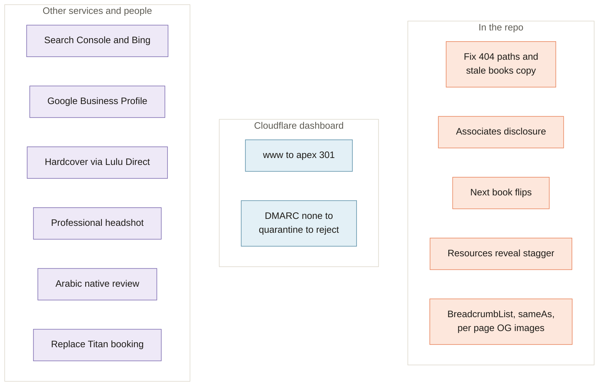

[Home](Home) › Past and future › **Roadmap**

# Roadmap

> [!NOTE]
> **At a glance.** What is planned but not shipped, grouped by who has to act. The source of truth is [`ROADMAP.md`](https://github.com/vijaybpanangi/ezziclarity/blob/main/ROADMAP.md) in the repo; this page summarises it and adds the fixes from [Known Issues](Known-Issues). Nothing here has a fixed date. When an item ships it moves to `CHANGELOG.md`.

## In the repo

| Item | Notes |
|---|---|
| Fix the visible issues | 404 paths, stale "not out yet" books copy, gateway centring. See [Known Issues](Known-Issues). |
| Amazon Associates disclosure | A translated line on the Books pages. |
| More books go live | The bookshelf pipeline has more picture books and a new Chapter Books line. Repeat the flip for each, in three languages. See [Books and Buy Links](Books-and-Buy-Links). |
| Direct hardcover sales | Lulu Direct, printed in Ontario. On site Shopify Buy Button or a link to lulu.com, still to decide. The second button slot is ready. |
| Resources reveal stagger | A small delay ladder across the nine resource cards. Cosmetic. |
| Deferred SEO | `BreadcrumbList` schema; `sameAs` once real profiles exist; per page Open Graph images; absolute `og:image`. |
| Real device pass | Check the site on a real phone and tablet, especially the Arabic pages. |

## In the Cloudflare dashboard

| Item | Notes |
|---|---|
| `www` to apex redirect | A 301 Redirect Rule. Canonicals already prefer the apex, so this is belt and braces. |
| DMARC ladder | After clean reports at `info@`, `p=none` to `quarantine`, then `reject`. Keep SPF at `~all`. |
| Retire Titan | When booking moves elsewhere, remove the Titan SPF include and `titan1` DKIM record in the same change. |
| Newsletter sender | If a bulk sender is ever added, use a subdomain such as `send.ezziclarity.ca` with its own records. |

## With other services or people

| Item | Notes |
|---|---|
| Search Console and Bing Webmaster Tools | Verify the domain and submit `https://ezziclarity.ca/sitemap.xml`. |
| Google Business Profile | Create and verify the listing for Maps and local search. |
| Professional headshot | Replace the interim founder portrait (`assets/images/arva-founder.jpg`) when one exists. |
| Arabic native review | Work through the June 2026 checklist. |

## Done since the last wiki update

The earlier wiki listed the email move and robots.txt behaviour as open. Both are settled: email has been on iCloud+ since June 2026 (v3.2.0), and the live `robots.txt` matched the repo file on 2026-11-09.

## Related pages

- [Known Issues](Known-Issues)
- [Release History](Release-History)
- [Decisions Log](Decisions-Log#decisions-still-open)

**Last checked:** 2026-11-09, against `ROADMAP.md` at `6c632f0` and the live site.

Sources

- `ROADMAP.md`: email, www redirect, deferred SEO, design follow ups, books, hardcover
- [Known Issues](Known-Issues) review of 2026-11-09
- `CHANGELOG.md` v3.2.0, v3.8.0, v3.9.0

