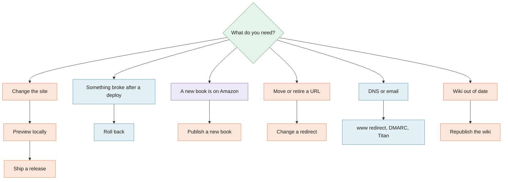

[Home](Home) › Working on it › **Runbooks**

# Runbooks

> [!NOTE]
> **At a glance.** Short, numbered step lists for the jobs that come up most: previewing, shipping a release, rolling back, publishing a book, changing a redirect, checking SEO, adding the `www` redirect, the email clean ups, and republishing this wiki. Each one says where the work happens: the repo, the Cloudflare dashboard, or another service.

## Preview locally

1. From the repo root: `python3 -m http.server 8000`
2. Open `http://localhost:8000/`, then each language's changed pages.
3. Narrow the window to phone width and open the menu.
4. Turn on reduced motion in your system settings once to check nothing stays hidden.

Note that the local server does not apply `_redirects` and serves its own 404, so check those on a preview URL.

## Ship a release

1. Open a pull request; check the Cloudflare branch preview.
2. Merge to `main`. Cloudflare publishes in about thirty seconds.
3. Open the changed pages on `https://ezziclarity.ca` in all three languages.
4. Pick the version (major, minor or patch) and note the merge commit's UTC time.
5. Add the `CHANGELOG.md` entry and a README release table row (in the same PR, or a docs follow up).
6. `git tag -a vX.Y.Z <merge sha> -m "Title"` then `git push origin vX.Y.Z`.

## Roll back

1. Cloudflare dashboard, `ezziclarity` Pages project, **Deployments**.
2. Find the last good deployment, open its menu, choose **Rollback to this deployment**.
3. In the repo, revert the bad commit in a pull request so the next deploy does not undo the rollback.
4. Note what happened in `CHANGELOG.md` with a patch release.

## Publish a new book

1. Get from the author: title, ages, one sentence blurb in EN, FR and AR, cover image, ASIN, formats and price.
2. Save the cover as `assets/images/books/<slug>-cover.jpg`, about 900 by 1440, stripped of metadata.
3. In Amazon Associates, use **SiteStripe** on the book's Amazon.ca page to get the tagged link (`tag=ezziclarity-20`).
4. In `en/books/`, `fr/livres/` and `ar/books/`, add or flip the card following its `<!-- FLIP TO LIVE -->` comment: real ``, "Available now" pill, Buy on Amazon button with `target="_blank" rel="noopener sponsored"`.
5. Add a `Book` node to each page's JSON-LD with the clean `https://www.amazon.ca/dp/<ASIN>` link, and check the price and currency.
6. Keep the grid balanced (three per row, or centre a short last row).
7. Update the section intro and closing call to action if they mention books "coming" or "not out yet".
8. Release as a minor version.

## Change a redirect

1. Edit `_redirects`: one rule per line, `<from> <to> <status>`. Put exact paths above `*` splat rules.
2. Merge, then test: `curl -sI https://ezziclarity.ca/old-path | grep -i location`.

## Check SEO after a change

1. View source: one absolute canonical, four `hreflang` links, `og:locale`.
2. Paste the page URL into a structured data validator (for example the Schema.org validator) and confirm the JSON-LD parses.
3. Confirm the page is in `sitemap.xml` with its alternates, and update its `lastmod`.

## Add the www to apex redirect

In the Cloudflare dashboard, `ezziclarity.ca`, **Rules**, **Redirect Rules**, **Create rule**: when `Hostname equals www.ezziclarity.ca`, redirect to the static target `https://ezziclarity.ca` with path and query preserved, status 301. Then `curl -sI https://www.ezziclarity.ca/en/` should show `301` and a `location` on the apex.

## Tighten DMARC

After a week or two of clean aggregate reports arriving at `info@`, edit the `_dmarc` TXT record in Cloudflare DNS from `p=none` to `p=quarantine`, wait again, then `p=reject`. Keep `~all` in SPF.

## Retire Titan booking

When the booking page is replaced, in one change: update the booking links on every page (header button, home, Contact, footer, in all three languages), remove `include:spf.titan.email` from the SPF record, and delete the `titan1._domainkey` TXT record.

## Republish the wiki

1. Edit pages under `docs/wiki/` in a pull request; the `wiki-sync` check runs on it.
2. Merge. The workflow publishes on any push to `main` that touches `docs/wiki/**`.
3. To publish without a change, run **Actions**, **wiki-sync**, **Run workflow** on `main`.

## Related pages

- [Deployment](Deployment)
- [Books and Buy Links](Books-and-Buy-Links)
- [Wiki Maintenance](Wiki-Maintenance)

**Last checked:** 2026-11-09, against `main` at `6c632f0`.

Sources

- `CLAUDE.md`, "Build, run, deploy" and "Releases and versioning"
- `ROADMAP.md`: email, www redirect, books and Titan retirement notes
- Book card `FLIP TO LIVE` comments in the three Books pages
- `CHANGELOG.md` v3.9.2 (SiteStripe links)

