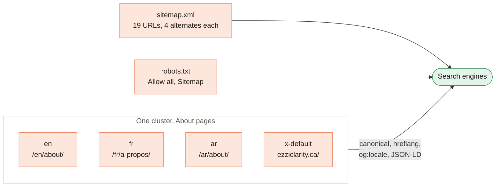

[Home](Home) › How the site works › **SEO**

# SEO

> [!NOTE]
> **At a glance.** The technical SEO foundation shipped in v3.1.0 (2026-06-15) and covers all 19 public pages: an absolute self canonical, a four way `hreflang` cluster (en, fr, ar, x-default), `og:locale` tags, a JSON-LD `@graph` (WebSite, ProfessionalService, Person, WebPage, plus `Book` nodes on the Books pages), a hand written `sitemap.xml` with hreflang alternates, and a `robots.txt` that allows everything and points at the sitemap. The bare apex `https://ezziclarity.ca/` is the preferred host everywhere.

*Every page belongs to a cluster of three equivalent pages plus the gateway as x-default. The About cluster is shown.*

## What each page carries

| Signal | Example (English About) | Notes |
|---|---|---|
| Title | `About` and the brand | Home pages use the tagline instead |
| Meta description | One or two sentences | Written per language |
| Canonical | `https://ezziclarity.ca/en/about/` | Always absolute, always the page itself |
| hreflang | en, fr, ar, x-default | The three pages in a cluster share an identical set |
| `og:locale` | `en_CA`, alternates `fr_CA` and `ar` | French uses `fr_CA`, Arabic `ar` |
| `og:title`, `og:description`, `og:type` | Per page | |
| `og:image` | `og-ezzi-clarity.png` | Shared by all pages, as an absolute URL (`https://ezziclarity.ca/assets/images/og-ezzi-clarity.png`) since v3.9.6 |
| JSON-LD | `@graph` before `</head>` | See below |

## Structured data

Every page carries the same three site wide nodes, with stable `@id`s, plus a node for the page itself:

| Node | `@id` | Holds |
|---|---|---|
| `WebSite` | `https://ezziclarity.ca/#website` | Name, URL, language, publisher |
| `ProfessionalService` | `https://ezziclarity.ca/#organization` | Legal name, logo, phone, `info@` email, area served, address, languages, founder, contact point |
| `Person` | `https://ezziclarity.ca/#founder` | Arva Ezzi, job title, OISE alumna, MEd credential |
| `WebPage` | `<page URL>#webpage` | The page's own title and description, `isPartOf` the website |
| `Book` (Books pages) | none | Name, author (the founder), cover, format, ages 4 to 8, an `Offer` with a clean Amazon.ca URL and the paperback price in `CAD` |

The JSON-LD reuses each page's own title and description word for word, so no new translated text was invented for it. There is deliberately no `sameAs` yet: add social or directory profiles only once they really exist.

## sitemap.xml and robots.txt

- `sitemap.xml` lists the gateway and the 18 language pages (19 `<url>` entries), each with an absolute `<loc>`, four `xhtml:link` alternates and a `<lastmod>`. Every `lastmod` reads 2026-11-09, when all pages last changed; update the dates of pages you change.
- `robots.txt` is four lines: `User-agent: *`, `Allow: /`, and the sitemap URL.
- On 2026-11-09 the live `robots.txt` matched the repo file exactly. Earlier in 2026 Cloudflare's AI Crawl Control prepended a managed block that disallowed AI training crawlers; if that toggle is switched back on, the live file will differ from the repo again. That is expected and harmless for search.

## Host choice

Both `ezziclarity.ca` and `www.ezziclarity.ca` serve the site with status 200. Canonicals, hreflang and the sitemap all name the bare apex, so search engines have a clear preference. A Cloudflare redirect rule from `www` to the apex is still on the [Roadmap](Roadmap) as belt and braces.

## Deferred

From `ROADMAP.md`: `BreadcrumbList` schema, `sameAs` links once profiles exist, per page Open Graph images, a Google Business Profile, and verifying the domain in Search Console and Bing Webmaster Tools so the sitemap can be submitted.

## When you add or rename a page

1. Give it an absolute canonical to itself.
2. Add the four `hreflang` links, and add the new page to the clusters on its two siblings.
3. Set `og:locale` and its alternates.
4. Add a JSON-LD `@graph` with the shared nodes and a `WebPage` node.
5. Add a `<url>` to `sitemap.xml` with all four alternates.

## Related pages

- [Languages and RTL](Languages-and-RTL)
- [Books and Buy Links](Books-and-Buy-Links): the `Book` nodes
- [Runbooks](Runbooks#check-seo-after-a-change): quick checks after a change

**Last checked:** 2026-11-09, against `main` at `6c632f0`; live `robots.txt` and `sitemap.xml` fetched the same day.

Sources

- `<head>` of `en/about/index.html` lines 7 to 23 and of `index.html`
- JSON-LD parsed from `index.html`, `en/index.html`, `en/books/index.html`
- `sitemap.xml` (19 entries, all `lastmod` 2026-11-09 since v3.9.6), `robots.txt`
- `CHANGELOG.md` v3.1.0 and v3.1.1; `ROADMAP.md` "Deferred SEO" and "www to apex"
- `curl https://ezziclarity.ca/robots.txt` and `curl -I https://www.ezziclarity.ca/` on 2026-11-09

