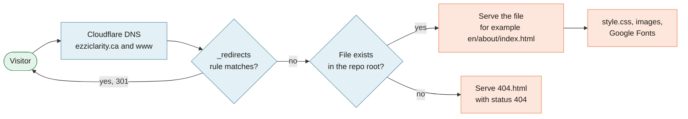

[Home](Home) › How the site works › **Site Architecture**

# Site Architecture

> [!NOTE]
> **At a glance.** The repo root *is* the website. There is no framework, no package manager, no bundler and no build step: 20 hand written HTML files, one stylesheet (`style.css`, about 2,160 lines), a shared `assets/images/` folder, and three small host files (`_redirects`, `sitemap.xml`, `robots.txt`). Cloudflare Pages serves the files as they are. The only JavaScript is a short inline script on each page for the mobile menu and scroll reveals.

## How a request is served



Folders map straight to URLs: `en/about/index.html` is served at `/en/about/`. Inner URLs always end in a slash.

## What is in the repo

```
/                     repo root = site root
├── index.html        language gateway
├── 404.html          not found page
├── _redirects        short paths and old /services URLs (Cloudflare Pages syntax)
├── sitemap.xml       19 URLs with hreflang alternates
├── robots.txt        allow all, points at the sitemap
├── style.css         every style for every page
├── assets/images/    shared images, book covers in assets/images/books/
├── en/  fr/  ar/     six pages each (see Pages and Features)
├── docs/
│   ├── superpowers/  design specs and implementation plans
│   ├── archive/      three earlier versions of the site, for history
│   └── wiki/         the source of this wiki
├── .github/workflows/wiki-sync.yml
├── README.md  CLAUDE.md  CHANGELOG.md  ROADMAP.md
└── .gitignore
```

> [!WARNING]
> Cloudflare Pages publishes **everything** in the repo root, including `README.md`, `CHANGELOG.md`, `docs/` and `docs/wiki/`. For example `https://ezziclarity.ca/README.md` returns 200. None of it is secret, and that is the accepted trade off, but never commit anything private to this repo.

## Relative paths shift with depth

All links and assets are relative, so the number of `../` depends on how deep a page sits:

| Page | Stylesheet | Image |
|---|---|---|
| `/index.html` | `style.css` | `assets/images/...` |
| `/404.html` | `/style.css` (root-relative, because it is served at any URL) | `/assets/images/...` |
| `/en/index.html` | `../style.css` | `../assets/images/...` |
| `/en/about/index.html` | `../../style.css` | `../../assets/images/...` |

When you add or move a page, recompute every `href` and `src`. Canonical, hreflang, JSON-LD and sitemap URLs are the exception: they are absolute (`https://ezziclarity.ca/...`).

## The redirects file

```
/home /en/ 301
/about /en/about/ 301
/services /en/consulting/ 301
/resources /en/resources/ 301
/contact /en/contact/ 301

/en/services    /en/consulting/        301
/fr/services    /fr/conseil/           301
/ar/services    /ar/consulting/        301
/en/services/*  /en/consulting/:splat  301
/fr/services/*  /fr/conseil/:splat     301
/ar/services/*  /ar/consulting/:splat  301
```

The first block gives short English paths. The second keeps links to the old Services pages working after the June 2026 rename to Consulting. Exact rules sit above the `*` rules because Cloudflare recommends that order (v2.0.1).

## The inline script

Each page ends with one inline `<script>` that:

1. toggles the mobile drawer (`.nav-toggle`, `#mobile-nav`, `aria-expanded`, `aria-hidden`, `body.nav-open`) and closes it on Escape;
2. adds a `.reveal` class and then `.is-visible` as sections scroll into view, only when the visitor has not asked for reduced motion.

It is copied, not shared, on purpose: one less request and nothing to break. The cost is that a behaviour change must be made in all 20 files.

## Third parties the site touches

| Service | Used for | Where |
|---|---|---|
| Cloudflare Pages, DNS, Registrar | Hosting, DNS, domain | Dashboard only, nothing in the repo |
| Google Fonts | Plus Jakarta Sans, Fraunces, IBM Plex Sans Arabic | `@import` at the top of `style.css` |
| Google Maps | Office map embed | Contact pages (`iframe`) |
| Titan | Intro call booking page | Header button and Contact pages |
| Amazon.ca | Book purchases (Associates links) | Books pages |
| iCloud+ Custom Email Domain | `info@` and `arva@` mailboxes | DNS only |

An external technical review of this repository lives in the separate `ezzi-clarity-os` repo (REV-1001). If a change adds a host, a third party service, a DNS or email provider, or a build system, flag it so that review is updated.

## Related pages

- [Deployment](Deployment): how the files reach Cloudflare
- [Languages and RTL](Languages-and-RTL): the three page trees
- [Design System](Design-System): what is inside `style.css`
- [Decisions Log](Decisions-Log): why there is no build step

**Last checked:** 2026-11-09, against `main` at `6c632f0`; redirects and the public `README.md` checked live with `curl`.

<details>
<summary>Sources</summary>

- Repository tree and `wc -l style.css` (2,157 lines) at `6c632f0`
- `_redirects`, `sitemap.xml`, `robots.txt`, `404.html`
- Inline script at the end of each HTML file
- `CLAUDE.md`, sections "Build, run, deploy", "Relative paths shift with depth" and the ECOS governance note
- Live: `/about` and `/services` return 301 to the English pages, `/fr/services/` to `/fr/conseil/`, `/README.md` returns 200

</details>
