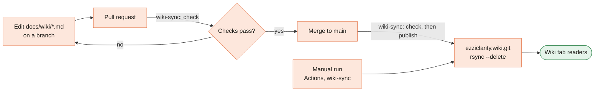

[Home](Home) › Working on it › **Wiki Maintenance**

# Wiki Maintenance

> [!NOTE]
> **At a glance.** This wiki is written in the main repo under `docs/wiki/`, reviewed in pull requests like any other change, and copied to the GitHub wiki by the **`wiki-sync`** workflow. The workflow checks every page (no em or en dashes, links and images resolve, every page has the standard parts) on pull requests, and publishes on pushes to `main` that touch `docs/wiki/` or on a manual run. **Edits made directly on the wiki tab are overwritten** on the next sync.



## Files

| Path | What it is |
|---|---|
| `docs/wiki/Home.md` | The wiki front page |
| `docs/wiki/_Sidebar.md`, `docs/wiki/_Footer.md` | Shown on every page |
| `docs/wiki/<Page-Name>.md` | One file per page; the file name is the page URL |
| `docs/wiki/images/` | Screenshots, referenced as `images/<name>.jpg` |
| `.github/workflows/wiki-sync.yml` | Checks on pull requests; checks and publishes on `main` and manual runs |
| `.github/scripts/check_wiki.py` | The checker the workflow runs |
| `.github/scripts/render_mermaid.js` | A local check that every Mermaid diagram renders |

The sync copies the folder with `rsync --delete`, so a page removed from `docs/wiki/` disappears from the wiki too. It uses the built in `GITHUB_TOKEN` with `contents: write`; no extra secret is needed. Note that `docs/wiki/` is also served publicly by Cloudflare Pages, like the rest of the repo.

## The page standard

Every content page has, in order:

1. a **breadcrumb** line starting `[Home](Home) ›`;
2. a title and an **"At a glance"** box (`> [!NOTE]`) that answers the page in a few sentences;
3. a **hero** diagram or screenshot;
4. the body, with tables where they help;
5. **Related pages**;
6. a **Last checked** date, and what it was checked against;
7. **Sources** in a collapsible `<details>` block.

`check_wiki.py` enforces the breadcrumb, the note, the date and the sources block.

## Writing rules

- **No em dashes or en dashes**, anywhere. Use a colon, a comma or a full stop. Write number ranges as "4 to 8". The checker fails on either character.
- **Warm, plain voice.** Short sentences, everyday words.
- **Check facts against the code** or the live site, and say what you checked in Sources.
- **No secrets and no personal data** beyond what the public site already shows. No AI model names.
- **Link pages by name**: `[Design System](Design-System)`, with an optional `#anchor`.

## Diagram colours

Colour shows who owns a box. Copy these class lines into every flowchart:

```
classDef ours fill:#FDE7DC,stroke:#E8835A,color:#1e1c18
classDef cloudflare fill:#E3F0F6,stroke:#5B8FA8,color:#1e1c18
classDef thirdparty fill:#EEE9F7,stroke:#7C6BB0,color:#1e1c18
classDef visitor fill:#E5F4EA,stroke:#3F8F5A,color:#1e1c18
```

| Class | Owner | Colour |
|---|---|---|
| `ours` | The repo, its pages, our process | Peach, from `--peach` |
| `cloudflare` | Cloudflare Pages, DNS, edge | Sky, from `--sky` |
| `thirdparty` | Amazon, Titan, Google, iCloud, WordPress.com | Violet |
| `visitor` | Visitors, readers, search engines | Green |

Give subgraphs a quiet frame (`style <name> fill:#FFFFFF,stroke:#DDD8CC`) so Mermaid's default yellow does not appear. Quote labels that contain slashes or dots, for example `EN["/en/ English"]`, or Mermaid reads them as shapes or links.

## Checking before you push

```bash
python3 .github/scripts/check_wiki.py docs/wiki
```

```bash
node .github/scripts/render_mermaid.js docs/wiki /tmp/mermaid-out
```

The second command opens each diagram in headless Chromium with Mermaid 11, reports any that fail, and writes PNGs so you can look at them.

## Refreshing screenshots

Screenshots come from the live site with Playwright, at 1280px wide (or 390px for phone views), device scale factor 2, reduced motion on, saved as JPEG quality 80 in `docs/wiki/images/`. Retake them after a visible change and update the page's Last checked date.

## Related pages

- [Runbooks](Runbooks#republish-the-wiki)
- [Editing Workflow](Editing-Workflow)

**Last checked:** 2026-11-09, when the wiki moved into the repo.

<details>
<summary>Sources</summary>

- `.github/workflows/wiki-sync.yml`, `.github/scripts/check_wiki.py`, `.github/scripts/render_mermaid.js`
- GitHub wiki repository `vijaybpanangi/ezziclarity.wiki.git` (default branch `master`, nine pages before this change)

</details>
